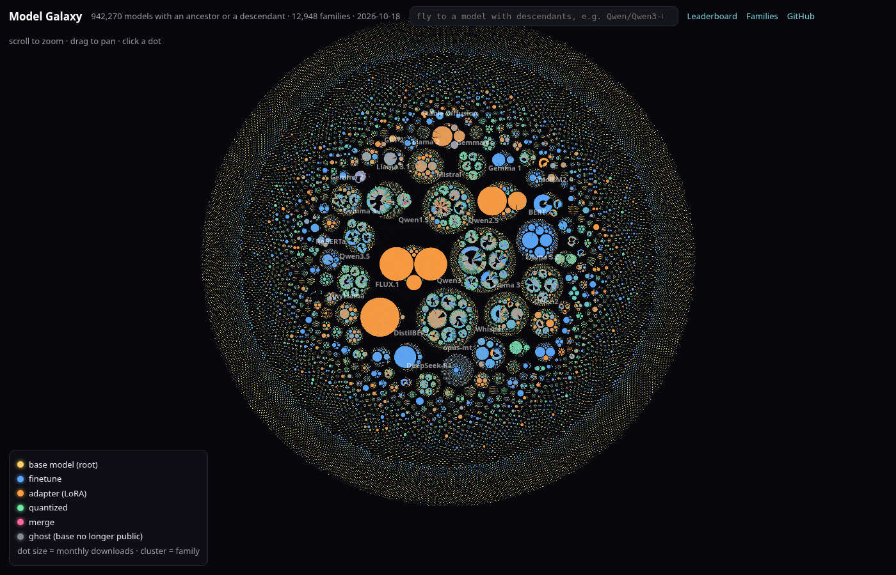

<div align="center">

<a href="https://h9-tec.github.io/model-family-tree/galaxy.html"></a>

**[Fly through the Model Galaxy →](https://h9-tec.github.io/model-family-tree/galaxy.html)** · 942,270 models in one zoomable WebGL map · **[Explorer →](https://h9-tec.github.io/model-family-tree/)** · search any model, walk its pedigree, share a link.

# Open Model Family Tree

**Every model on the Hugging Face Hub, its ancestry, and a leaderboard of the base models the ecosystem actually builds on. Rebuilt nightly.**


[](https://github.com/h9-tec/model-family-tree/stargazers)
[](LICENSE)

</div>

**3,161,429** models · **897,225** declare a base model (28%) · **930,179** parent links · **88,174** models have descendants · **45,007** roots in **23,964** families

The most built-on model on the Hub is **[black-forest-labs/FLUX.1-dev](https://huggingface.co/black-forest-labs/FLUX.1-dev)** with **43,699** descendants. In the last 90 days it is **[Qwen/Qwen3.8-27B](https://huggingface.co/Qwen/Qwen3.8-27B)** with **4,531** new ones. The biggest family is **Qwen1.5** (71,020).

## Install into your agent

```bash
claude plugin marketplace add h9-tec/model-family-tree
claude plugin install model-family-tree@model-family-tree
```

Requires [uv](https://docs.astral.sh/uv/) on PATH. Then ask Claude: *what is unsloth/Qwen2.5-7B-Instruct based on, and which Qwen base has the most finetunes?* It answers from the `lineage` and `leaderboard` MCP tools.

<details>
<summary>Any MCP client</summary>

```json
{"mcpServers": {"model-family-tree": {"command": "uv", "args": ["run", "--frozen", "--no-dev", "--directory", "/path/to/model-family-tree", "python", "mcp/server.py"]}}}
```

Tools: `lineage(id)`, `children(id)`, `leaderboard(kind)`, `family(name)`, `search(query)`.

</details>

## See it

| | |
|---|---|
| **[Galaxy](https://h9-tec.github.io/model-family-tree/galaxy.html)** | Every model that has an ancestor or a descendant (942,270 points) in one WebGL map. Families are circle-packed clusters, base models are stars, each derivative is a dot colored by relation and sized by downloads. Scroll to zoom from the whole Hub down to one model, click any dot. |
| **[Explorer](https://h9-tec.github.io/model-family-tree/)** | Type any model id. Its pedigree is drawn as a radial tree: every ancestor path fans out to the left (merges show all parents), the most downloaded descendants to the right, unfoldable level by level, live from the Hub. |
| **[Leaderboard](https://h9-tec.github.io/model-family-tree/#board:all)** | All 88,174 models with descendants, sortable and filterable, plus the curated views below. |

<a href="assets/families.svg"></a>

## Most-descended base models

Unique descendants of every kind: finetunes, adapters (LoRA), quantizations and merges, each counted once however many paths reach it. † marks a base that was deleted or made private but is still referenced. [Full top 500 →](docs/tables/models_all_time.md)

| # | Model | Descendants | Direct | Last 90d | Finetune / adapter / quantized / merge | Family |
|---:|---|---:|---:|---:|---|---|
| 1 | [black-forest-labs/FLUX.1-dev](https://huggingface.co/black-forest-labs/FLUX.1-dev) | 43,699 | 43,430 | 226 | 678 / 42,878 / 129 / 14 | FLUX.1 |
| 2 | [Qwen/Qwen1.5-0.5B](https://huggingface.co/Qwen/Qwen1.5-0.5B) | 32,564 | 32,534 | 0 | 41 / 32,475 / 46 / 2 | Qwen1.5 |
| 3 | [Qwen/Qwen1.5-1.8B](https://huggingface.co/Qwen/Qwen1.5-1.8B) | 30,656 | 30,626 | 0 | 35 / 30,591 / 28 / 2 | Qwen1.5 |
| 4 | [google/gemma-2b](https://huggingface.co/google/gemma-2b) | 24,115 | 24,035 | 11 | 309 / 23,706 / 89 / 11 | Gemma 1 |
| 5 | [Qwen/Qwen2.5-7B](https://huggingface.co/Qwen/Qwen2.5-7B) | 22,660 | 2,076 | 3,179 | 11,720 / 6,856 / 3,490 / 594 | Qwen2.5 |
| 6 | [meta-llama/Llama-3.1-8B](https://huggingface.co/meta-llama/Llama-3.1-8B) | 21,642 | 3,259 | 2,587 | 9,606 / 6,112 / 5,081 / 843 | Llama 3.1 |
| 7 | [meta-llama/Llama-3.1-8B-Instruct](https://huggingface.co/meta-llama/Llama-3.1-8B-Instruct) | 15,242 | 7,279 | 1,843 | 6,908 / 4,047 / 3,575 / 712 | Llama 3.1 |
| 8 | [Qwen/Qwen2.5-7B-Instruct](https://huggingface.co/Qwen/Qwen2.5-7B-Instruct) | 14,290 | 6,596 | 2,273 | 8,239 / 3,862 / 1,779 / 410 | Qwen2.5 |
| 9 | [distilbert/distilbert-base-uncased](https://huggingface.co/distilbert/distilbert-base-uncased) | 13,599 | 13,219 | 783 | 13,054 / 395 / 149 / 1 | DistilBERT |
| 10 | [mistralai/Mistral-7B-v0.1](https://huggingface.co/mistralai/Mistral-7B-v0.1) | 11,598 | 4,012 | 67 | 2,971 / 5,190 / 2,057 / 1,365 | Mistral |
| 11 | [stabilityai/stable-diffusion-xl-base-1.0](https://huggingface.co/stabilityai/stable-diffusion-xl-base-1.0) | 11,491 | 11,009 | 158 | 1,417 / 9,974 / 48 / 52 | Stable Diffusion |
| 12 | [Qwen/Qwen3-4B-Instruct-2507](https://huggingface.co/Qwen/Qwen3-4B-Instruct-2507) | 10,991 | 8,765 | 1,394 | 3,341 / 6,503 / 1,050 / 97 | Qwen3 |
| 13 | [Qwen/Qwen2.5-1.5B](https://huggingface.co/Qwen/Qwen2.5-1.5B) | 10,758 | 1,023 | 1,640 | 4,905 / 4,022 / 1,674 / 157 | Qwen2.5 |
| 14 | [meta-llama/Meta-Llama-3-8B](https://huggingface.co/meta-llama/Meta-Llama-3-8B) | 10,275 | 1,724 | 123 | 4,206 / 2,069 / 3,013 / 987 | Llama 3 |
| 15 | [google/gemma-7b](https://huggingface.co/google/gemma-7b) | 9,852 | 9,585 | 3 | 453 / 9,294 / 97 / 8 | Gemma 1 |
| 16 | [HuggingFaceTB/SmolLM2-360M](https://huggingface.co/HuggingFaceTB/SmolLM2-360M) | 9,709 | 193 | 1,756 | 8,761 / 595 / 348 / 5 | SmolLM2 |
| 17 | [Qwen/Qwen2.5-0.5B](https://huggingface.co/Qwen/Qwen2.5-0.5B) | 9,490 | 1,361 | 934 | 5,952 / 2,198 / 1,285 / 55 | Qwen2.5 |
| 18 | [Qwen/Qwen3-8B-Base](https://huggingface.co/Qwen/Qwen3-8B-Base) | 9,447 | 842 | 1,857 | 4,737 / 2,869 / 1,768 / 72 | Qwen3 |
| 19 | [HuggingFaceTB/SmolLM2-360M-Instruct](https://huggingface.co/HuggingFaceTB/SmolLM2-360M-Instruct) | 9,248 | 377 | 1,708 | 8,606 / 362 / 275 / 5 | SmolLM2 |
| 20 | [HuggingFaceTB/SmolVLM-500M-Instruct](https://huggingface.co/HuggingFaceTB/SmolVLM-500M-Instruct) | 8,570 | 92 | 1,613 | 8,371 / 133 / 66 / 0 | SmolLM2 |
| 21 | [Qwen/Qwen2.5-3B](https://huggingface.co/Qwen/Qwen2.5-3B) | 8,484 | 1,133 | 1,346 | 3,816 / 3,093 / 1,490 / 85 | Qwen2.5 |
| 22 | [HuggingFaceTB/SmolVLM2-500M-Video-Instruct](https://huggingface.co/HuggingFaceTB/SmolVLM2-500M-Video-Instruct) | 8,469 | 127 | 1,593 | 8,337 / 102 / 30 / 0 | SmolLM2 |
| 23 | [lerobot/smolvla_base](https://huggingface.co/lerobot/smolvla_base) | 8,338 | 8,292 | 1,575 | 8,247 / 85 / 6 / 0 | SmolLM2 |
| 24 | [Qwen/Qwen3-8B](https://huggingface.co/Qwen/Qwen3-8B) | 7,884 | 5,040 | 1,491 | 3,707 / 2,650 / 1,458 / 68 | Qwen3 |
| 25 | [meta-llama/Llama-3.2-3B-Instruct](https://huggingface.co/meta-llama/Llama-3.2-3B-Instruct) | 7,516 | 3,467 | 793 | 3,920 / 1,597 / 1,847 / 152 | Llama 3.2 |

## Hot right now: new descendants in the last 90 days

[Full top 500 →](docs/tables/models_90d.md)

| # | Model | Descendants | Direct | Last 90d | Finetune / adapter / quantized / merge | Family |
|---:|---|---:|---:|---:|---|---|
| 1 | [Qwen/Qwen3.8-27B](https://huggingface.co/Qwen/Qwen3.8-27B) | 4,533 | 2,272 | 4,531 | 824 / 343 / 3,311 / 55 | Qwen3.8 |
| 2 | [Qwen/Qwen2.5-7B](https://huggingface.co/Qwen/Qwen2.5-7B) | 22,660 | 2,076 | 3,179 | 11,720 / 6,856 / 3,490 / 594 | Qwen2.5 |
| 3 | [Qwen/Qwen3.5-9B-Base](https://huggingface.co/Qwen/Qwen3.5-9B-Base) | 5,855 | 741 | 3,059 | 2,353 / 1,233 / 2,166 / 103 | Qwen3.5 |
| 4 | [meta-llama/Llama-3.1-8B](https://huggingface.co/meta-llama/Llama-3.1-8B) | 21,642 | 3,259 | 2,587 | 9,606 / 6,112 / 5,081 / 843 | Llama 3.1 |
| 5 | [Qwen/Qwen3.5-9B](https://huggingface.co/Qwen/Qwen3.5-9B) | 4,765 | 2,518 | 2,398 | 1,574 / 1,152 / 1,939 / 100 | Qwen3.5 |
| 6 | [Qwen/Qwen3.5-4B-Base](https://huggingface.co/Qwen/Qwen3.5-4B-Base) | 4,455 | 342 | 2,367 | 1,733 / 1,205 / 1,481 / 36 | Qwen3.5 |
| 7 | [Qwen/Qwen2.5-7B-Instruct](https://huggingface.co/Qwen/Qwen2.5-7B-Instruct) | 14,290 | 6,596 | 2,273 | 8,239 / 3,862 / 1,779 / 410 | Qwen2.5 |
| 8 | [Qwen/Qwen3.5-4B](https://huggingface.co/Qwen/Qwen3.5-4B) | 3,935 | 2,288 | 2,040 | 1,451 / 1,091 / 1,361 / 32 | Qwen3.5 |
| 9 | [Qwen/Qwen3-8B-Base](https://huggingface.co/Qwen/Qwen3-8B-Base) | 9,447 | 842 | 1,857 | 4,737 / 2,869 / 1,768 / 72 | Qwen3 |
| 10 | [meta-llama/Llama-3.1-8B-Instruct](https://huggingface.co/meta-llama/Llama-3.1-8B-Instruct) | 15,242 | 7,279 | 1,843 | 6,908 / 4,047 / 3,575 / 712 | Llama 3.1 |
| 11 | [HuggingFaceTB/SmolLM2-360M](https://huggingface.co/HuggingFaceTB/SmolLM2-360M) | 9,709 | 193 | 1,756 | 8,761 / 595 / 348 / 5 | SmolLM2 |
| 12 | [HuggingFaceTB/SmolLM2-360M-Instruct](https://huggingface.co/HuggingFaceTB/SmolLM2-360M-Instruct) | 9,248 | 377 | 1,708 | 8,606 / 362 / 275 / 5 | SmolLM2 |
| 13 | [Qwen/Qwen2.5-1.5B](https://huggingface.co/Qwen/Qwen2.5-1.5B) | 10,758 | 1,023 | 1,640 | 4,905 / 4,022 / 1,674 / 157 | Qwen2.5 |
| 14 | [HuggingFaceTB/SmolVLM-500M-Instruct](https://huggingface.co/HuggingFaceTB/SmolVLM-500M-Instruct) | 8,570 | 92 | 1,613 | 8,371 / 133 / 66 / 0 | SmolLM2 |
| 15 | [HuggingFaceTB/SmolVLM2-500M-Video-Instruct](https://huggingface.co/HuggingFaceTB/SmolVLM2-500M-Video-Instruct) | 8,469 | 127 | 1,593 | 8,337 / 102 / 30 / 0 | SmolLM2 |
| 16 | [lerobot/smolvla_base](https://huggingface.co/lerobot/smolvla_base) | 8,338 | 8,292 | 1,575 | 8,247 / 85 / 6 / 0 | SmolLM2 |
| 17 | [Qwen/Qwen3-0.6B-Base](https://huggingface.co/Qwen/Qwen3-0.6B-Base) | 6,461 | 914 | 1,575 | 3,751 / 972 / 1,712 / 26 | Qwen3 |
| 18 | [Qwen/Qwen3-8B](https://huggingface.co/Qwen/Qwen3-8B) | 7,884 | 5,040 | 1,491 | 3,707 / 2,650 / 1,458 / 68 | Qwen3 |
| 19 | [Qwen/Qwen3-4B-Instruct-2507](https://huggingface.co/Qwen/Qwen3-4B-Instruct-2507) | 10,991 | 8,765 | 1,394 | 3,341 / 6,503 / 1,050 / 97 | Qwen3 |
| 20 | [Qwen/Qwen2.5-3B](https://huggingface.co/Qwen/Qwen2.5-3B) | 8,484 | 1,133 | 1,346 | 3,816 / 3,093 / 1,490 / 85 | Qwen2.5 |
| 21 | [krea/Krea-2-Raw](https://huggingface.co/krea/Krea-2-Raw) | 2,902 | 1,058 | 1,234 | 108 / 2,723 / 68 / 3 | krea-2-raw |
| 22 | [Qwen/Qwen3.5-0.8B-Base](https://huggingface.co/Qwen/Qwen3.5-0.8B-Base) | 2,450 | 241 | 1,234 | 938 / 657 / 846 / 9 | Qwen3.5 |
| 23 | [Qwen/Qwen3.6-35B-A3B](https://huggingface.co/Qwen/Qwen3.6-35B-A3B) | 2,868 | 1,666 | 1,218 | 495 / 483 / 1,843 / 46 | Qwen3.6 |
| 24 | [Qwen/Qwen3-4B-Base](https://huggingface.co/Qwen/Qwen3-4B-Base) | 6,675 | 681 | 1,149 | 3,367 / 1,630 / 1,584 / 94 | Qwen3 |
| 25 | [Qwen/Qwen3-1.7B-Base](https://huggingface.co/Qwen/Qwen3-1.7B-Base) | 4,805 | 583 | 1,097 | 2,692 / 984 / 1,109 / 20 | Qwen3 |

## Finetunes only

Adapters and quantizations inflate the all-time table (tens of thousands of auto-generated LoRAs sit on a few small bases). This view counts descendants whose own relation to their parent is `finetune`. [Full top 500 →](docs/tables/models_finetune.md)

| # | Model | Descendants | Direct | Last 90d | Finetune / adapter / quantized / merge | Family |
|---:|---|---:|---:|---:|---|---|
| 1 | [distilbert/distilbert-base-uncased](https://huggingface.co/distilbert/distilbert-base-uncased) | 13,599 | 13,219 | 783 | 13,054 / 395 / 149 / 1 | DistilBERT |
| 2 | [Qwen/Qwen2.5-7B](https://huggingface.co/Qwen/Qwen2.5-7B) | 22,660 | 2,076 | 3,179 | 11,720 / 6,856 / 3,490 / 594 | Qwen2.5 |
| 3 | [meta-llama/Llama-3.1-8B](https://huggingface.co/meta-llama/Llama-3.1-8B) | 21,642 | 3,259 | 2,587 | 9,606 / 6,112 / 5,081 / 843 | Llama 3.1 |
| 4 | [HuggingFaceTB/SmolLM2-360M](https://huggingface.co/HuggingFaceTB/SmolLM2-360M) | 9,709 | 193 | 1,756 | 8,761 / 595 / 348 / 5 | SmolLM2 |
| 5 | [HuggingFaceTB/SmolLM2-360M-Instruct](https://huggingface.co/HuggingFaceTB/SmolLM2-360M-Instruct) | 9,248 | 377 | 1,708 | 8,606 / 362 / 275 / 5 | SmolLM2 |
| 6 | [HuggingFaceTB/SmolVLM-500M-Instruct](https://huggingface.co/HuggingFaceTB/SmolVLM-500M-Instruct) | 8,570 | 92 | 1,613 | 8,371 / 133 / 66 / 0 | SmolLM2 |
| 7 | [HuggingFaceTB/SmolVLM2-500M-Video-Instruct](https://huggingface.co/HuggingFaceTB/SmolVLM2-500M-Video-Instruct) | 8,469 | 127 | 1,593 | 8,337 / 102 / 30 / 0 | SmolLM2 |
| 8 | [lerobot/smolvla_base](https://huggingface.co/lerobot/smolvla_base) | 8,338 | 8,292 | 1,575 | 8,247 / 85 / 6 / 0 | SmolLM2 |
| 9 | [Qwen/Qwen2.5-7B-Instruct](https://huggingface.co/Qwen/Qwen2.5-7B-Instruct) | 14,290 | 6,596 | 2,273 | 8,239 / 3,862 / 1,779 / 410 | Qwen2.5 |
| 10 | [google-bert/bert-base-uncased](https://huggingface.co/google-bert/bert-base-uncased) | 7,445 | 7,206 | 258 | 7,221 / 147 / 70 / 7 | BERT |
| 11 | [meta-llama/Llama-3.1-8B-Instruct](https://huggingface.co/meta-llama/Llama-3.1-8B-Instruct) | 15,242 | 7,279 | 1,843 | 6,908 / 4,047 / 3,575 / 712 | Llama 3.1 |
| 12 | [Qwen/Qwen2.5-0.5B](https://huggingface.co/Qwen/Qwen2.5-0.5B) | 9,490 | 1,361 | 934 | 5,952 / 2,198 / 1,285 / 55 | Qwen2.5 |
| 13 | [Qwen/Qwen2.5-1.5B](https://huggingface.co/Qwen/Qwen2.5-1.5B) | 10,758 | 1,023 | 1,640 | 4,905 / 4,022 / 1,674 / 157 | Qwen2.5 |
| 14 | [Qwen/Qwen3-8B-Base](https://huggingface.co/Qwen/Qwen3-8B-Base) | 9,447 | 842 | 1,857 | 4,737 / 2,869 / 1,768 / 72 | Qwen3 |
| 15 | [FacebookAI/xlm-roberta-base](https://huggingface.co/FacebookAI/xlm-roberta-base) | 4,726 | 4,364 | 204 | 4,534 / 78 / 113 / 0 | XLM-RoBERTa |
| 16 | [unsloth/Qwen2.5-7B-Instruct](https://huggingface.co/unsloth/Qwen2.5-7B-Instruct) | 5,312 | 5,270 | 876 | 4,509 / 772 / 29 / 2 | Qwen2.5 |
| 17 | [google/gemma-3-4b-pt](https://huggingface.co/google/gemma-3-4b-pt) | 6,662 | 395 | 583 | 4,505 / 939 / 1,202 / 16 | Gemma 3 |
| 18 | [meta-llama/Meta-Llama-3-8B](https://huggingface.co/meta-llama/Meta-Llama-3-8B) | 10,275 | 1,724 | 123 | 4,206 / 2,069 / 3,013 / 987 | Llama 3 |
| 19 | [aubmindlab/bert-base-arabertv02](https://huggingface.co/aubmindlab/bert-base-arabertv02) | 4,112 | 4,055 | 14 | 4,103 / 5 / 4 / 0 | BERT |
| 20 | [openai/whisper-small](https://huggingface.co/openai/whisper-small) | 4,718 | 4,394 | 355 | 4,058 / 347 / 313 / 0 | Whisper |
| 21 | [meta-llama/Llama-3.2-3B-Instruct](https://huggingface.co/meta-llama/Llama-3.2-3B-Instruct) | 7,516 | 3,467 | 793 | 3,920 / 1,597 / 1,847 / 152 | Llama 3.2 |
| 22 | [Qwen/Qwen2.5-3B](https://huggingface.co/Qwen/Qwen2.5-3B) | 8,484 | 1,133 | 1,346 | 3,816 / 3,093 / 1,490 / 85 | Qwen2.5 |
| 23 | [Qwen/Qwen3-0.6B-Base](https://huggingface.co/Qwen/Qwen3-0.6B-Base) | 6,461 | 914 | 1,575 | 3,751 / 972 / 1,712 / 26 | Qwen3 |
| 24 | [Qwen/Qwen3-8B](https://huggingface.co/Qwen/Qwen3-8B) | 7,884 | 5,040 | 1,491 | 3,707 / 2,650 / 1,458 / 68 | Qwen3 |
| 25 | [Qwen/Qwen3-4B-Base](https://huggingface.co/Qwen/Qwen3-4B-Base) | 6,675 | 681 | 1,149 | 3,367 / 1,630 / 1,584 / 94 | Qwen3 |

## Families

Roots grouped by series name across organizations (so `unsloth/Llama-3.1-8B` re-uploads count toward Llama 3.1). Grouping is a heuristic with hand overrides in [`data/families.yaml`](data/families.yaml); PRs welcome. [Full table →](docs/tables/families.md)

<a href="assets/monthly.svg"></a>

| # | Family | Descendants | Last 90d | Roots | Finetune / adapter / quantized / merge | Biggest root |
|---:|---|---:|---:|---:|---|---|
| 1 | **Qwen1.5** | 71,020 | 6 | 44 | 223 / 70,433 / 348 / 16 | [Qwen/Qwen1.5-0.5B](https://huggingface.co/Qwen/Qwen1.5-0.5B) |
| 2 | **Qwen2.5** | 69,454 | 8,357 | 693 | 33,556 / 19,764 / 14,511 / 1,623 | [Qwen/Qwen2.5-7B](https://huggingface.co/Qwen/Qwen2.5-7B) |
| 3 | **Qwen3** | 53,881 | 10,185 | 641 | 23,856 / 16,889 / 12,693 / 441 | [Qwen/Qwen3-4B-Instruct-2507](https://huggingface.co/Qwen/Qwen3-4B-Instruct-2507) |
| 4 | **FLUX.1** | 44,159 | 256 | 16 | 770 / 43,183 / 191 / 15 | [black-forest-labs/FLUX.1-dev](https://huggingface.co/black-forest-labs/FLUX.1-dev) |
| 5 | **Gemma 1** | 37,054 | 54 | 184 | 1,751 / 34,349 / 886 / 68 | [google/gemma-2b](https://huggingface.co/google/gemma-2b) |
| 6 | **Mistral** | 36,431 | 1,041 | 582 | 10,606 / 11,226 / 11,652 / 2,931 | [mistralai/Mistral-7B-v0.1](https://huggingface.co/mistralai/Mistral-7B-v0.1) |
| 7 | **Llama 3.1** | 28,226 | 2,800 | 222 | 11,133 / 6,995 / 8,159 / 1,939 | [meta-llama/Llama-3.1-8B](https://huggingface.co/meta-llama/Llama-3.1-8B) |
| 8 | **Llama 3** | 24,181 | 415 | 543 | 8,062 / 5,859 / 7,794 / 2,466 | [meta-llama/Meta-Llama-3-8B](https://huggingface.co/meta-llama/Meta-Llama-3-8B) |
| 9 | **BERT** | 23,168 | 595 | 305 | 22,399 / 508 / 253 / 8 | [google-bert/bert-base-uncased](https://huggingface.co/google-bert/bert-base-uncased) |
| 10 | **Llama 3.2** | 21,066 | 1,623 | 477 | 9,673 / 5,712 / 5,085 / 596 | [meta-llama/Llama-3.2-3B-Instruct](https://huggingface.co/meta-llama/Llama-3.2-3B-Instruct) |
| 11 | **Qwen3.5** | 18,489 | 8,519 | 147 | 6,996 / 3,982 / 7,307 / 203 | [Qwen/Qwen3.5-9B-Base](https://huggingface.co/Qwen/Qwen3.5-9B-Base) |
| 12 | **Gemma 3** | 18,147 | 1,411 | 140 | 10,568 / 2,976 / 4,382 / 221 | [google/gemma-3-4b-pt](https://huggingface.co/google/gemma-3-4b-pt) |
| 13 | **Stable Diffusion** | 17,845 | 308 | 29 | 3,413 / 14,267 / 95 / 70 | [stabilityai/stable-diffusion-xl-base-1.0](https://huggingface.co/stabilityai/stable-diffusion-xl-base-1.0) |
| 14 | **Whisper** | 15,633 | 1,639 | 196 | 11,637 / 2,332 / 1,657 / 7 | [openai/whisper-small](https://huggingface.co/openai/whisper-small) |
| 15 | **DistilBERT** | 15,172 | 848 | 81 | 14,398 / 495 / 278 / 1 | [distilbert/distilbert-base-uncased](https://huggingface.co/distilbert/distilbert-base-uncased) |
| 16 | **SmolLM2** | 13,552 | 2,076 | 59 | 10,836 / 1,585 / 1,111 / 20 | [HuggingFaceTB/SmolLM2-360M](https://huggingface.co/HuggingFaceTB/SmolLM2-360M) |
| 17 | **Gemma 2** | 12,322 | 473 | 226 | 5,069 / 3,171 / 3,141 / 941 | [google/gemma-2-9b](https://huggingface.co/google/gemma-2-9b) |
| 18 | **Llama 2** | 11,619 | 275 | 413 | 2,973 / 7,066 / 1,367 / 213 | [meta-llama/Llama-2-7b-hf](https://huggingface.co/meta-llama/Llama-2-7b-hf) |
| 19 | **Gemma 4** | 10,784 | 3,790 | 126 | 3,181 / 1,947 / 5,501 / 155 | [google/gemma-4-31B](https://huggingface.co/google/gemma-4-31B) |
| 20 | **Qwen2** | 10,762 | 200 | 167 | 3,162 / 6,024 / 1,488 / 88 | [Qwen/Qwen2-0.5B](https://huggingface.co/Qwen/Qwen2-0.5B) |
| 21 | **DeepSeek-R1** | 8,878 | 414 | 129 | 2,700 / 1,512 / 3,774 / 892 | [deepseek-ai/DeepSeek-R1-Distill-Qwen-1.5B](https://huggingface.co/deepseek-ai/DeepSeek-R1-Distill-Qwen-1.5B) |
| 22 | **XLM-RoBERTa** | 6,305 | 313 | 48 | 5,996 / 137 / 171 / 0 | [FacebookAI/xlm-roberta-base](https://huggingface.co/FacebookAI/xlm-roberta-base) |
| 23 | **ViT** | 6,076 | 179 | 66 | 5,194 / 752 / 130 / 0 | [google/vit-base-patch16-224-in21k](https://huggingface.co/google/vit-base-patch16-224-in21k) |
| 24 | **TinyLlama** | 5,895 | 111 | 127 | 1,431 / 3,491 / 880 / 93 | [TinyLlama/TinyLlama-1.1B-Chat-v1.0](https://huggingface.co/TinyLlama/TinyLlama-1.1B-Chat-v1.0) |
| 25 | **Qwen3.6** | 5,888 | 2,244 | 50 | 1,096 / 1,118 / 3,577 / 90 | [Qwen/Qwen3.6-35B-A3B](https://huggingface.co/Qwen/Qwen3.6-35B-A3B) |

## Organizations

Descendants of every root owned by the organization, deduplicated. [Full table →](docs/tables/orgs.md)

| # | Organization | Descendants of its roots | Last 90d | Roots | Biggest root |
|---:|---|---:|---:|---:|---|
| 1 | [Qwen](https://huggingface.co/Qwen) | 232,823 | 35,724 | 148 | [Qwen/Qwen1.5-0.5B](https://huggingface.co/Qwen/Qwen1.5-0.5B) |
| 2 | [google](https://huggingface.co/google) | 91,482 | 7,415 | 325 | [google/gemma-2b](https://huggingface.co/google/gemma-2b) |
| 3 | [meta-llama](https://huggingface.co/meta-llama) | 68,807 | 4,914 | 50 | [meta-llama/Llama-3.1-8B](https://huggingface.co/meta-llama/Llama-3.1-8B) |
| 4 | [black-forest-labs](https://huggingface.co/black-forest-labs) | 46,075 | 689 | 20 | [black-forest-labs/FLUX.1-dev](https://huggingface.co/black-forest-labs/FLUX.1-dev) |
| 5 | [mistralai](https://huggingface.co/mistralai) | 32,662 | 1,399 | 30 | [mistralai/Mistral-7B-v0.1](https://huggingface.co/mistralai/Mistral-7B-v0.1) |
| 6 | [unsloth](https://huggingface.co/unsloth) | 24,198 | 409 | 269 | [unsloth/llama-3-8b-Instruct-bnb-4bit](https://huggingface.co/unsloth/llama-3-8b-Instruct-bnb-4bit) |
| 7 | [microsoft](https://huggingface.co/microsoft) | 22,254 | 1,362 | 255 | [microsoft/Phi-3-mini-4k-instruct](https://huggingface.co/microsoft/Phi-3-mini-4k-instruct) |
| 8 | [openai](https://huggingface.co/openai) | 19,333 | 1,987 | 21 | [openai/whisper-small](https://huggingface.co/openai/whisper-small) |
| 9 | [facebook](https://huggingface.co/facebook) | 17,611 | 1,279 | 490 | [facebook/wav2vec2-base](https://huggingface.co/facebook/wav2vec2-base) |
| 10 | [distilbert](https://huggingface.co/distilbert) | 17,509 | 959 | 9 | [distilbert/distilbert-base-uncased](https://huggingface.co/distilbert/distilbert-base-uncased) |
| 11 | [HuggingFaceTB](https://huggingface.co/HuggingFaceTB) | 16,141 | 2,228 | 29 | [HuggingFaceTB/SmolLM2-360M](https://huggingface.co/HuggingFaceTB/SmolLM2-360M) |
| 12 | [stabilityai](https://huggingface.co/stabilityai) | 15,208 | 247 | 73 | [stabilityai/stable-diffusion-xl-base-1.0](https://huggingface.co/stabilityai/stable-diffusion-xl-base-1.0) |
| 13 | [google-bert](https://huggingface.co/google-bert) | 14,679 | 372 | 12 | [google-bert/bert-base-uncased](https://huggingface.co/google-bert/bert-base-uncased) |
| 14 | [deepseek-ai](https://huggingface.co/deepseek-ai) | 14,016 | 1,430 | 77 | [deepseek-ai/DeepSeek-R1-Distill-Qwen-1.5B](https://huggingface.co/deepseek-ai/DeepSeek-R1-Distill-Qwen-1.5B) |
| 15 | [FacebookAI](https://huggingface.co/FacebookAI) | 9,888 | 467 | 19 | [FacebookAI/xlm-roberta-base](https://huggingface.co/FacebookAI/xlm-roberta-base) |

## How it works

1. **Source.** The daily [`cfahlgren1/hub-stats`](https://huggingface.co/datasets/cfahlgren1/hub-stats) dump of the Hub's `/api/models` (Apache-2.0), which carries the `base_model` metadata model authors declare in their cards, plus the legacy `base_model:` tags as a fallback.
2. **Graph.** Child → parent edges with the declared relation (`finetune`, `adapter`, `quantized`, `merge`). Merges give a DAG, mis-tagged cards give the occasional cycle (67 nodes today); both are handled.
3. **Counts.** Descendant sets are built children-first and unioned, so every model is counted once per ancestor. `direct` is declared children; `total` is the whole subtree.
4. **Families.** Roots (models that declare no parent) are grouped by a series heuristic over the model name, with overrides in `data/families.yaml`.
5. **Galaxy layout.** Each root's subtree is a radial tree (depth rings sized by population, wedges by subtree size); roots are circle-packed inside their family and families into the galaxy, with a port of d3's front-chain packing. Positions ship as a 10 MB binary, ids load lazily in chunks.
6. **Refresh.** A GitHub Action rebuilds everything nightly, commits `dist/` and `README.md`, and attaches the full node and edge tables plus the galaxy data to the [`data-latest`](https://github.com/h9-tec/model-family-tree/releases/tag/data-latest) release, which the site reads.

### Caveats

- **Declared ancestry only.** 28% of models declare a base. Untagged re-uploads and GGUF conversions without metadata are invisible, so every number is a floor.
- **Activity, not quality.** A base with 30,000 adapters was mostly a tutorial default. Read the finetune-only and 90-day tables alongside the all-time one.
- **Ghost parents.** 3,938 referenced bases are no longer public. They stay in the tree, marked †.
- **Families are heuristic.** Series detection is a regex over names. Fix a wrong grouping by editing `data/families.yaml`.

## Data files

| File | What |
|---|---|
| [`dist/leaderboard.json`](dist/leaderboard.json) | Top 500 models (all time, 90 days, finetune-only), families, organizations |
| [`dist/parents.json`](dist/parents.json) | Every model with descendants, compact columns |
| [`dist/timeseries.json`](dist/timeseries.json) | Monthly new descendants for the top families and models |
| [`dist/children_top.json`](dist/children_top.json) | Top 25 children by downloads for the 3,000 most-descended parents |
| [`dist/llms.txt`](dist/llms.txt) | Plain-text summary for LLMs |
| `data-latest` release | `nodes.parquet` and `edges.parquet`, the full graph |

## Build it yourself

```bash
uv sync
uv run python scripts/build.py all        # downloads the dump (~1.6 GB), builds in about 15 seconds
uv run python scripts/build.py build      # rebuild from the cached dump
uv run pytest
```

## Related

- [Arabic AI Atlas](https://github.com/h9-tec/arabic-ai-atlas): the same idea for one language's ecosystem, with a map.
- Hugging Face shows the tree for one model on its page; this repo aggregates the whole Hub.

## License

Code MIT. Generated data CC BY 4.0, derived from Hub metadata via `cfahlgren1/hub-stats` (Apache-2.0).

*Generated 2026-10-18.*
