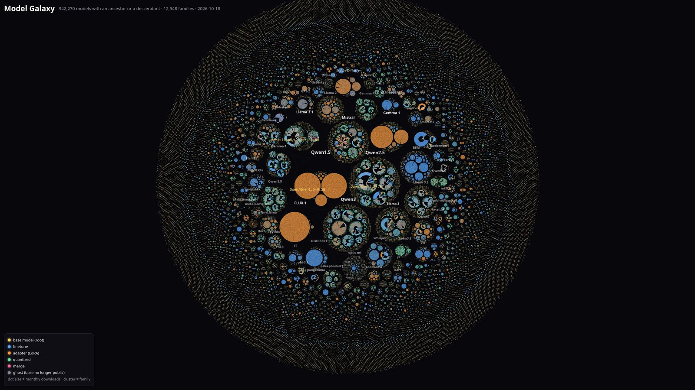

<div align="center">

<a href="https://h9-tec.github.io/model-family-tree/galaxy.html"></a>

**[Fly through the Model Galaxy →](https://h9-tec.github.io/model-family-tree/galaxy.html)** · 988,219 models in one zoomable WebGL map · **[Explorer →](https://h9-tec.github.io/model-family-tree/)** · search any model, walk its pedigree, share a link.

# Open Model Family Tree

**Every model on the Hugging Face Hub, its ancestry, and a leaderboard of the base models the ecosystem actually builds on. Rebuilt nightly.**


[](https://github.com/h9-tec/model-family-tree/stargazers)
[](LICENSE)

</div>

**3,256,633** models · **941,309** declare a base model (29%) · **974,712** parent links · **93,660** models have descendants · **46,872** roots in **25,135** families

The most built-on model on the Hub is **[black-forest-labs/FLUX.1-dev](https://huggingface.co/black-forest-labs/FLUX.1-dev)** with **43,716** descendants. In the last 90 days it is **[Qwen/Qwen3.8-27B](https://huggingface.co/Qwen/Qwen3.8-27B)** with **5,175** new ones. The biggest family is **Qwen2.5** (72,499).

## Install into your agent

```bash
claude plugin marketplace add h9-tec/model-family-tree
claude plugin install model-family-tree@model-family-tree
```

Requires [uv](https://docs.astral.sh/uv/) on PATH. Then ask Claude: *what is unsloth/Qwen2.5-7B-Instruct based on, and which Qwen base has the most finetunes?* It answers from the `lineage` and `leaderboard` MCP tools.

<details>
<summary>Any MCP client</summary>

```json
{"mcpServers": {"model-family-tree": {"command": "uv", "args": ["run", "--frozen", "--no-dev", "--directory", "/path/to/model-family-tree", "python", "mcp/server.py"]}}}
```

Tools: `lineage(id)`, `children(id)`, `leaderboard(kind)`, `family(name)`, `search(query)`.

</details>

## See it

| | |
|---|---|
| **[Galaxy](https://h9-tec.github.io/model-family-tree/galaxy.html)** | Every model that has an ancestor or a descendant (988,219 points) in one WebGL map. Families are circle-packed clusters, base models are stars, each derivative is a dot colored by relation and sized by downloads. Scroll to zoom from the whole Hub down to one model, click any dot. |
| **[Explorer](https://h9-tec.github.io/model-family-tree/)** | Type any model id. Its pedigree is drawn as a radial tree: every ancestor path fans out to the left (merges show all parents), the most downloaded descendants to the right, unfoldable level by level, live from the Hub. |
| **[Leaderboard](https://h9-tec.github.io/model-family-tree/#board:all)** | All 93,660 models with descendants, sortable and filterable, plus the curated views below. |

<a href="assets/families.svg"></a>

## Most-descended base models

Unique descendants of every kind: finetunes, adapters (LoRA), quantizations and merges, each counted once however many paths reach it. † marks a base that was deleted or made private but is still referenced. [Full top 500 →](docs/tables/models_all_time.md)

| # | Model | Descendants | Direct | Last 90d | Finetune / adapter / quantized / merge | Family |
|---:|---|---:|---:|---:|---|---|
| 1 | [black-forest-labs/FLUX.1-dev](https://huggingface.co/black-forest-labs/FLUX.1-dev) | 43,716 | 43,439 | 220 | 696 / 42,868 / 136 / 16 | FLUX.1 |
| 2 | [Qwen/Qwen1.5-0.5B](https://huggingface.co/Qwen/Qwen1.5-0.5B) | 32,562 | 32,534 | 0 | 40 / 32,475 / 45 / 2 | Qwen1.5 |
| 3 | [Qwen/Qwen1.5-1.8B](https://huggingface.co/Qwen/Qwen1.5-1.8B) | 30,658 | 30,628 | 2 | 36 / 30,591 / 29 / 2 | Qwen1.5 |
| 4 | [google/gemma-2b](https://huggingface.co/google/gemma-2b) | 24,118 | 24,038 | 8 | 312 / 23,706 / 89 / 11 | Gemma 1 |
| 5 | [Qwen/Qwen2.5-7B](https://huggingface.co/Qwen/Qwen2.5-7B) | 23,340 | 2,009 | 2,584 | 12,253 / 6,885 / 3,609 / 593 | Qwen2.5 |
| 6 | [meta-llama/Llama-3.1-8B](https://huggingface.co/meta-llama/Llama-3.1-8B) | 21,865 | 3,231 | 1,749 | 9,621 / 6,211 / 5,183 / 850 | Llama 3.1 |
| 7 | [meta-llama/Llama-3.1-8B-Instruct](https://huggingface.co/meta-llama/Llama-3.1-8B-Instruct) | 15,449 | 7,494 | 1,371 | 6,959 / 4,134 / 3,638 / 718 | Llama 3.1 |
| 8 | [Qwen/Qwen2.5-7B-Instruct](https://huggingface.co/Qwen/Qwen2.5-7B-Instruct) | 15,097 | 6,851 | 1,985 | 8,831 / 4,013 / 1,842 / 411 | Qwen2.5 |
| 9 | [distilbert/distilbert-base-uncased](https://huggingface.co/distilbert/distilbert-base-uncased) | 13,801 | 13,419 | 720 | 13,237 / 404 / 159 / 1 | DistilBERT |
| 10 | [mistralai/Mistral-7B-v0.1](https://huggingface.co/mistralai/Mistral-7B-v0.1) | 11,642 | 4,015 | 86 | 3,006 / 5,185 / 2,071 / 1,365 | Mistral |
| 11 | [stabilityai/stable-diffusion-xl-base-1.0](https://huggingface.co/stabilityai/stable-diffusion-xl-base-1.0) | 11,598 | 11,113 | 246 | 1,426 / 10,062 / 56 / 54 | Stable Diffusion |
| 12 | [Qwen/Qwen2.5-1.5B](https://huggingface.co/Qwen/Qwen2.5-1.5B) | 11,590 | 1,095 | 1,939 | 5,273 / 4,329 / 1,823 / 165 | Qwen2.5 |
| 13 | [Qwen/Qwen3-4B-Instruct-2507](https://huggingface.co/Qwen/Qwen3-4B-Instruct-2507) | 11,442 | 9,065 | 1,614 | 3,639 / 6,557 / 1,153 / 93 | Qwen3 |
| 14 | [meta-llama/Meta-Llama-3-8B](https://huggingface.co/meta-llama/Meta-Llama-3-8B) | 10,327 | 1,727 | 102 | 4,250 / 2,073 / 3,015 / 989 | Llama 3 |
| 15 | [Qwen/Qwen3-8B-Base](https://huggingface.co/Qwen/Qwen3-8B-Base) | 10,185 | 931 | 2,069 | 5,075 / 3,130 / 1,906 / 73 | Qwen3 |
| 16 | [HuggingFaceTB/SmolLM2-360M](https://huggingface.co/HuggingFaceTB/SmolLM2-360M) | 10,181 | 206 | 1,617 | 9,145 / 663 / 368 / 5 | SmolLM2 |
| 17 | [Qwen/Qwen2.5-0.5B](https://huggingface.co/Qwen/Qwen2.5-0.5B) | 10,144 | 1,493 | 1,309 | 6,221 / 2,460 / 1,403 / 60 | Qwen2.5 |
| 18 | [google/gemma-7b](https://huggingface.co/google/gemma-7b) | 9,862 | 9,589 | 9 | 460 / 9,296 / 98 / 8 | Gemma 1 |
| 19 | [HuggingFaceTB/SmolLM2-360M-Instruct](https://huggingface.co/HuggingFaceTB/SmolLM2-360M-Instruct) | 9,708 | 434 | 1,574 | 8,980 / 430 / 293 / 5 | SmolLM2 |
| 20 | [HuggingFaceTB/SmolVLM-500M-Instruct](https://huggingface.co/HuggingFaceTB/SmolVLM-500M-Instruct) | 8,928 | 93 | 1,395 | 8,695 / 165 / 68 / 0 | SmolLM2 |
| 21 | [Qwen/Qwen2.5-3B](https://huggingface.co/Qwen/Qwen2.5-3B) | 8,881 | 1,148 | 1,186 | 3,964 / 3,238 / 1,594 / 85 | Qwen2.5 |
| 22 | [HuggingFaceTB/SmolVLM2-500M-Video-Instruct](https://huggingface.co/HuggingFaceTB/SmolVLM2-500M-Video-Instruct) | 8,826 | 141 | 1,379 | 8,661 / 134 / 31 / 0 | SmolLM2 |
| 23 | [lerobot/smolvla_base](https://huggingface.co/lerobot/smolvla_base) | 8,681 | 8,615 | 1,358 | 8,558 / 116 / 7 / 0 | SmolLM2 |
| 24 | [Qwen/Qwen3-8B](https://huggingface.co/Qwen/Qwen3-8B) | 8,398 | 5,437 | 1,581 | 3,858 / 2,895 / 1,575 / 69 | Qwen3 |
| 25 | [google-bert/bert-base-uncased](https://huggingface.co/google-bert/bert-base-uncased) | 7,704 | 7,459 | 461 | 7,465 / 148 / 84 / 7 | BERT |

## Hot right now: new descendants in the last 90 days

[Full top 500 →](docs/tables/models_90d.md)

| # | Model | Descendants | Direct | Last 90d | Finetune / adapter / quantized / merge | Family |
|---:|---|---:|---:|---:|---|---|
| 1 | [Qwen/Qwen3.8-27B](https://huggingface.co/Qwen/Qwen3.8-27B) | 6,664 | 3,277 | 5,175 | 1,524 / 574 / 4,493 / 73 | Qwen3.8 |
| 2 | [Qwen/Qwen3.5-4B-Base](https://huggingface.co/Qwen/Qwen3.5-4B-Base) | 6,573 | 548 | 3,866 | 2,647 / 1,826 / 2,039 / 61 | Qwen3.5 |
| 3 | [Qwen/Qwen3.5-9B-Base](https://huggingface.co/Qwen/Qwen3.5-9B-Base) | 7,432 | 816 | 3,618 | 2,952 / 1,636 / 2,720 / 124 | Qwen3.5 |
| 4 | [Qwen/Qwen3.5-4B](https://huggingface.co/Qwen/Qwen3.5-4B) | 5,792 | 3,508 | 3,346 | 2,225 / 1,632 / 1,879 / 56 | Qwen3.5 |
| 5 | [Qwen/Qwen3.5-9B](https://huggingface.co/Qwen/Qwen3.5-9B) | 6,226 | 3,371 | 3,155 | 2,122 / 1,517 / 2,466 / 121 | Qwen3.5 |
| 6 | [Qwen/Qwen2.5-7B](https://huggingface.co/Qwen/Qwen2.5-7B) | 23,340 | 2,009 | 2,584 | 12,253 / 6,885 / 3,609 / 593 | Qwen2.5 |
| 7 | [Qwen/Qwen3.5-0.8B-Base](https://huggingface.co/Qwen/Qwen3.5-0.8B-Base) | 3,784 | 322 | 2,311 | 1,560 / 1,063 / 1,151 / 10 | Qwen3.5 |
| 8 | [Qwen/Qwen3-8B-Base](https://huggingface.co/Qwen/Qwen3-8B-Base) | 10,185 | 931 | 2,069 | 5,075 / 3,130 / 1,906 / 73 | Qwen3 |
| 9 | [Qwen/Qwen3.5-0.8B](https://huggingface.co/Qwen/Qwen3.5-0.8B) | 3,269 | 2,189 | 1,996 | 1,330 / 962 / 969 / 8 | Qwen3.5 |
| 10 | [Qwen/Qwen2.5-7B-Instruct](https://huggingface.co/Qwen/Qwen2.5-7B-Instruct) | 15,097 | 6,851 | 1,985 | 8,831 / 4,013 / 1,842 / 411 | Qwen2.5 |
| 11 | [Qwen/Qwen2.5-1.5B](https://huggingface.co/Qwen/Qwen2.5-1.5B) | 11,590 | 1,095 | 1,939 | 5,273 / 4,329 / 1,823 / 165 | Qwen2.5 |
| 12 | [Qwen/Qwen3-0.6B-Base](https://huggingface.co/Qwen/Qwen3-0.6B-Base) | 7,153 | 1,008 | 1,750 | 4,095 / 1,133 / 1,900 / 25 | Qwen3 |
| 13 | [meta-llama/Llama-3.1-8B](https://huggingface.co/meta-llama/Llama-3.1-8B) | 21,865 | 3,231 | 1,749 | 9,621 / 6,211 / 5,183 / 850 | Llama 3.1 |
| 14 | [HuggingFaceTB/SmolLM2-360M](https://huggingface.co/HuggingFaceTB/SmolLM2-360M) | 10,181 | 206 | 1,617 | 9,145 / 663 / 368 / 5 | SmolLM2 |
| 15 | [Qwen/Qwen3-4B-Instruct-2507](https://huggingface.co/Qwen/Qwen3-4B-Instruct-2507) | 11,442 | 9,065 | 1,614 | 3,639 / 6,557 / 1,153 / 93 | Qwen3 |
| 16 | [Qwen/Qwen3-8B](https://huggingface.co/Qwen/Qwen3-8B) | 8,398 | 5,437 | 1,581 | 3,858 / 2,895 / 1,575 / 69 | Qwen3 |
| 17 | [HuggingFaceTB/SmolLM2-360M-Instruct](https://huggingface.co/HuggingFaceTB/SmolLM2-360M-Instruct) | 9,708 | 434 | 1,574 | 8,980 / 430 / 293 / 5 | SmolLM2 |
| 18 | [Qwen/Qwen3.8-Flash-Next](https://huggingface.co/Qwen/Qwen3.8-Flash-Next) | 1,462 | 854 | 1,461 | 230 / 12 / 1,170 / 50 | Qwen3.8 |
| 19 | [Qwen/Qwen3.5-2B-Base](https://huggingface.co/Qwen/Qwen3.5-2B-Base) | 2,775 | 223 | 1,439 | 1,216 / 654 / 897 / 8 | Qwen3.5 |
| 20 | [HuggingFaceTB/SmolVLM-500M-Instruct](https://huggingface.co/HuggingFaceTB/SmolVLM-500M-Instruct) | 8,928 | 93 | 1,395 | 8,695 / 165 / 68 / 0 | SmolLM2 |
| 21 | [HuggingFaceTB/SmolVLM2-500M-Video-Instruct](https://huggingface.co/HuggingFaceTB/SmolVLM2-500M-Video-Instruct) | 8,826 | 141 | 1,379 | 8,661 / 134 / 31 / 0 | SmolLM2 |
| 22 | [meta-llama/Llama-3.1-8B-Instruct](https://huggingface.co/meta-llama/Llama-3.1-8B-Instruct) | 15,449 | 7,494 | 1,371 | 6,959 / 4,134 / 3,638 / 718 | Llama 3.1 |
| 23 | [Qwen/Qwen3-1.7B-Base](https://huggingface.co/Qwen/Qwen3-1.7B-Base) | 5,483 | 690 | 1,368 | 2,950 / 1,211 / 1,301 / 21 | Qwen3 |
| 24 | [lerobot/smolvla_base](https://huggingface.co/lerobot/smolvla_base) | 8,681 | 8,615 | 1,358 | 8,558 / 116 / 7 / 0 | SmolLM2 |
| 25 | [Qwen/Qwen3-4B-Base](https://huggingface.co/Qwen/Qwen3-4B-Base) | 7,166 | 775 | 1,334 | 3,617 / 1,752 / 1,704 / 93 | Qwen3 |

## Finetunes only

Adapters and quantizations inflate the all-time table (tens of thousands of auto-generated LoRAs sit on a few small bases). This view counts descendants whose own relation to their parent is `finetune`. [Full top 500 →](docs/tables/models_finetune.md)

| # | Model | Descendants | Direct | Last 90d | Finetune / adapter / quantized / merge | Family |
|---:|---|---:|---:|---:|---|---|
| 1 | [distilbert/distilbert-base-uncased](https://huggingface.co/distilbert/distilbert-base-uncased) | 13,801 | 13,419 | 720 | 13,237 / 404 / 159 / 1 | DistilBERT |
| 2 | [Qwen/Qwen2.5-7B](https://huggingface.co/Qwen/Qwen2.5-7B) | 23,340 | 2,009 | 2,584 | 12,253 / 6,885 / 3,609 / 593 | Qwen2.5 |
| 3 | [meta-llama/Llama-3.1-8B](https://huggingface.co/meta-llama/Llama-3.1-8B) | 21,865 | 3,231 | 1,749 | 9,621 / 6,211 / 5,183 / 850 | Llama 3.1 |
| 4 | [HuggingFaceTB/SmolLM2-360M](https://huggingface.co/HuggingFaceTB/SmolLM2-360M) | 10,181 | 206 | 1,617 | 9,145 / 663 / 368 / 5 | SmolLM2 |
| 5 | [HuggingFaceTB/SmolLM2-360M-Instruct](https://huggingface.co/HuggingFaceTB/SmolLM2-360M-Instruct) | 9,708 | 434 | 1,574 | 8,980 / 430 / 293 / 5 | SmolLM2 |
| 6 | [Qwen/Qwen2.5-7B-Instruct](https://huggingface.co/Qwen/Qwen2.5-7B-Instruct) | 15,097 | 6,851 | 1,985 | 8,831 / 4,013 / 1,842 / 411 | Qwen2.5 |
| 7 | [HuggingFaceTB/SmolVLM-500M-Instruct](https://huggingface.co/HuggingFaceTB/SmolVLM-500M-Instruct) | 8,928 | 93 | 1,395 | 8,695 / 165 / 68 / 0 | SmolLM2 |
| 8 | [HuggingFaceTB/SmolVLM2-500M-Video-Instruct](https://huggingface.co/HuggingFaceTB/SmolVLM2-500M-Video-Instruct) | 8,826 | 141 | 1,379 | 8,661 / 134 / 31 / 0 | SmolLM2 |
| 9 | [lerobot/smolvla_base](https://huggingface.co/lerobot/smolvla_base) | 8,681 | 8,615 | 1,358 | 8,558 / 116 / 7 / 0 | SmolLM2 |
| 10 | [google-bert/bert-base-uncased](https://huggingface.co/google-bert/bert-base-uncased) | 7,704 | 7,459 | 461 | 7,465 / 148 / 84 / 7 | BERT |
| 11 | [meta-llama/Llama-3.1-8B-Instruct](https://huggingface.co/meta-llama/Llama-3.1-8B-Instruct) | 15,449 | 7,494 | 1,371 | 6,959 / 4,134 / 3,638 / 718 | Llama 3.1 |
| 12 | [Qwen/Qwen2.5-0.5B](https://huggingface.co/Qwen/Qwen2.5-0.5B) | 10,144 | 1,493 | 1,309 | 6,221 / 2,460 / 1,403 / 60 | Qwen2.5 |
| 13 | [Qwen/Qwen2.5-1.5B](https://huggingface.co/Qwen/Qwen2.5-1.5B) | 11,590 | 1,095 | 1,939 | 5,273 / 4,329 / 1,823 / 165 | Qwen2.5 |
| 14 | [Qwen/Qwen3-8B-Base](https://huggingface.co/Qwen/Qwen3-8B-Base) | 10,185 | 931 | 2,069 | 5,075 / 3,130 / 1,906 / 73 | Qwen3 |
| 15 | [unsloth/Qwen2.5-7B-Instruct](https://huggingface.co/unsloth/Qwen2.5-7B-Instruct) | 5,718 | 5,669 | 852 | 4,909 / 772 / 35 / 2 | Qwen2.5 |
| 16 | [FacebookAI/xlm-roberta-base](https://huggingface.co/FacebookAI/xlm-roberta-base) | 4,823 | 4,458 | 201 | 4,614 / 79 / 129 / 0 | XLM-RoBERTa |
| 17 | [google/gemma-3-4b-pt](https://huggingface.co/google/gemma-3-4b-pt) | 6,891 | 401 | 571 | 4,575 / 1,073 / 1,227 / 16 | Gemma 3 |
| 18 | [meta-llama/Meta-Llama-3-8B](https://huggingface.co/meta-llama/Meta-Llama-3-8B) | 10,327 | 1,727 | 102 | 4,250 / 2,073 / 3,015 / 989 | Llama 3 |
| 19 | [openai/whisper-small](https://huggingface.co/openai/whisper-small) | 4,849 | 4,497 | 338 | 4,139 / 363 / 347 / 0 | Whisper |
| 20 | [aubmindlab/bert-base-arabertv02](https://huggingface.co/aubmindlab/bert-base-arabertv02) | 4,116 | 4,060 | 15 | 4,105 / 5 / 6 / 0 | BERT |
| 21 | [Qwen/Qwen3-0.6B-Base](https://huggingface.co/Qwen/Qwen3-0.6B-Base) | 7,153 | 1,008 | 1,750 | 4,095 / 1,133 / 1,900 / 25 | Qwen3 |
| 22 | [meta-llama/Llama-3.2-3B-Instruct](https://huggingface.co/meta-llama/Llama-3.2-3B-Instruct) | 7,629 | 3,543 | 474 | 3,973 / 1,619 / 1,884 / 153 | Llama 3.2 |
| 23 | [Qwen/Qwen2.5-3B](https://huggingface.co/Qwen/Qwen2.5-3B) | 8,881 | 1,148 | 1,186 | 3,964 / 3,238 / 1,594 / 85 | Qwen2.5 |
| 24 | [Qwen/Qwen3-8B](https://huggingface.co/Qwen/Qwen3-8B) | 8,398 | 5,437 | 1,581 | 3,858 / 2,895 / 1,575 / 69 | Qwen3 |
| 25 | [Qwen/Qwen3-4B-Instruct-2507](https://huggingface.co/Qwen/Qwen3-4B-Instruct-2507) | 11,442 | 9,065 | 1,614 | 3,639 / 6,557 / 1,153 / 93 | Qwen3 |

## Families

Roots grouped by series name across organizations (so `unsloth/Llama-3.1-8B` re-uploads count toward Llama 3.1). Grouping is a heuristic with hand overrides in [`data/families.yaml`](data/families.yaml); PRs welcome. [Full table →](docs/tables/families.md)

<a href="assets/monthly.svg"></a>

| # | Family | Descendants | Last 90d | Roots | Finetune / adapter / quantized / merge | Biggest root |
|---:|---|---:|---:|---:|---|---|
| 1 | **Qwen2.5** | 72,499 | 8,358 | 688 | 35,046 / 20,739 / 15,081 / 1,633 | [Qwen/Qwen2.5-7B](https://huggingface.co/Qwen/Qwen2.5-7B) |
| 2 | **Qwen1.5** | 71,027 | 9 | 45 | 224 / 70,435 / 352 / 16 | [Qwen/Qwen1.5-0.5B](https://huggingface.co/Qwen/Qwen1.5-0.5B) |
| 3 | **Qwen3** | 57,985 | 10,693 | 656 | 25,876 / 18,014 / 13,661 / 432 | [Qwen/Qwen3-4B-Instruct-2507](https://huggingface.co/Qwen/Qwen3-4B-Instruct-2507) |
| 4 | **FLUX.1** | 44,180 | 250 | 16 | 790 / 43,173 / 200 / 17 | [black-forest-labs/FLUX.1-dev](https://huggingface.co/black-forest-labs/FLUX.1-dev) |
| 5 | **Gemma 1** | 37,088 | 65 | 185 | 1,761 / 34,368 / 891 / 68 | [google/gemma-2b](https://huggingface.co/google/gemma-2b) |
| 6 | **Mistral** | 36,737 | 1,002 | 586 | 10,711 / 11,281 / 11,794 / 2,935 | [mistralai/Mistral-7B-v0.1](https://huggingface.co/mistralai/Mistral-7B-v0.1) |
| 7 | **Llama 3.1** | 28,440 | 1,895 | 223 | 11,142 / 7,103 / 8,257 / 1,938 | [meta-llama/Llama-3.1-8B](https://huggingface.co/meta-llama/Llama-3.1-8B) |
| 8 | **Qwen3.5** | 24,558 | 12,067 | 158 | 9,535 / 5,659 / 9,090 / 273 | [Qwen/Qwen3.5-9B-Base](https://huggingface.co/Qwen/Qwen3.5-9B-Base) |
| 9 | **Llama 3** | 24,321 | 441 | 545 | 8,183 / 5,873 / 7,804 / 2,461 | [meta-llama/Meta-Llama-3-8B](https://huggingface.co/meta-llama/Meta-Llama-3-8B) |
| 10 | **BERT** | 23,675 | 922 | 307 | 22,821 / 513 / 333 / 8 | [google-bert/bert-base-uncased](https://huggingface.co/google-bert/bert-base-uncased) |
| 11 | **Llama 3.2** | 21,310 | 1,150 | 478 | 9,840 / 5,713 / 5,159 / 598 | [meta-llama/Llama-3.2-3B-Instruct](https://huggingface.co/meta-llama/Llama-3.2-3B-Instruct) |
| 12 | **Gemma 3** | 18,579 | 1,349 | 141 | 10,726 / 3,173 / 4,461 / 219 | [google/gemma-3-4b-pt](https://huggingface.co/google/gemma-3-4b-pt) |
| 13 | **Stable Diffusion** | 18,154 | 579 | 31 | 3,434 / 14,534 / 112 / 74 | [stabilityai/stable-diffusion-xl-base-1.0](https://huggingface.co/stabilityai/stable-diffusion-xl-base-1.0) |
| 14 | **Whisper** | 16,104 | 1,759 | 207 | 11,852 / 2,382 / 1,862 / 8 | [openai/whisper-small](https://huggingface.co/openai/whisper-small) |
| 15 | **DistilBERT** | 15,399 | 784 | 81 | 14,600 / 504 / 294 / 1 | [distilbert/distilbert-base-uncased](https://huggingface.co/distilbert/distilbert-base-uncased) |
| 16 | **SmolLM2** | 14,269 | 2,069 | 61 | 11,351 / 1,716 / 1,182 / 20 | [HuggingFaceTB/SmolLM2-360M](https://huggingface.co/HuggingFaceTB/SmolLM2-360M) |
| 17 | **Gemma 4** | 12,954 | 4,561 | 140 | 3,941 / 2,354 / 6,471 / 188 | [google/gemma-4-E4B](https://huggingface.co/google/gemma-4-E4B) |
| 18 | **Gemma 2** | 12,401 | 390 | 226 | 5,078 / 3,262 / 3,119 / 942 | [google/gemma-2-9b](https://huggingface.co/google/gemma-2-9b) |
| 19 | **Llama 2** | 11,689 | 297 | 412 | 3,010 / 7,087 / 1,379 / 213 | [meta-llama/Llama-2-7b-hf](https://huggingface.co/meta-llama/Llama-2-7b-hf) |
| 20 | **Qwen2** | 10,828 | 170 | 164 | 3,195 / 6,051 / 1,494 / 88 | [Qwen/Qwen2-0.5B](https://huggingface.co/Qwen/Qwen2-0.5B) |
| 21 | **DeepSeek-R1** | 9,152 | 541 | 130 | 2,894 / 1,539 / 3,821 / 898 | [deepseek-ai/DeepSeek-R1-Distill-Qwen-1.5B](https://huggingface.co/deepseek-ai/DeepSeek-R1-Distill-Qwen-1.5B) |
| 22 | **Qwen3.8** | 8,397 | 6,809 | 74 | 1,792 / 592 / 5,891 / 122 | [Qwen/Qwen3.8-27B](https://huggingface.co/Qwen/Qwen3.8-27B) |
| 23 | **XLM-RoBERTa** | 6,489 | 372 | 49 | 6,151 / 137 / 200 / 0 | [FacebookAI/xlm-roberta-base](https://huggingface.co/FacebookAI/xlm-roberta-base) |
| 24 | **Qwen3.6** | 6,485 | 1,685 | 55 | 1,303 / 1,191 / 3,889 / 95 | [Qwen/Qwen3.6-35B-A3B](https://huggingface.co/Qwen/Qwen3.6-35B-A3B) |
| 25 | **ViT** | 6,155 | 186 | 74 | 5,255 / 753 / 147 / 0 | [google/vit-base-patch16-224-in21k](https://huggingface.co/google/vit-base-patch16-224-in21k) |

## Organizations

Descendants of every root owned by the organization, deduplicated. [Full table →](docs/tables/orgs.md)

| # | Organization | Descendants of its roots | Last 90d | Roots | Biggest root |
|---:|---|---:|---:|---:|---|
| 1 | [Qwen](https://huggingface.co/Qwen) | 249,951 | 40,818 | 149 | [Qwen/Qwen1.5-0.5B](https://huggingface.co/Qwen/Qwen1.5-0.5B) |
| 2 | [google](https://huggingface.co/google) | 94,729 | 8,120 | 330 | [google/gemma-2b](https://huggingface.co/google/gemma-2b) |
| 3 | [meta-llama](https://huggingface.co/meta-llama) | 69,480 | 3,614 | 51 | [meta-llama/Llama-3.1-8B](https://huggingface.co/meta-llama/Llama-3.1-8B) |
| 4 | [black-forest-labs](https://huggingface.co/black-forest-labs) | 46,285 | 780 | 20 | [black-forest-labs/FLUX.1-dev](https://huggingface.co/black-forest-labs/FLUX.1-dev) |
| 5 | [mistralai](https://huggingface.co/mistralai) | 33,163 | 1,396 | 33 | [mistralai/Mistral-7B-v0.1](https://huggingface.co/mistralai/Mistral-7B-v0.1) |
| 6 | [unsloth](https://huggingface.co/unsloth) | 24,261 | 270 | 270 | [unsloth/llama-3-8b-Instruct-bnb-4bit](https://huggingface.co/unsloth/llama-3-8b-Instruct-bnb-4bit) |
| 7 | [microsoft](https://huggingface.co/microsoft) | 22,769 | 1,204 | 259 | [microsoft/Phi-3-mini-4k-instruct](https://huggingface.co/microsoft/Phi-3-mini-4k-instruct) |
| 8 | [openai](https://huggingface.co/openai) | 19,916 | 2,084 | 21 | [openai/whisper-small](https://huggingface.co/openai/whisper-small) |
| 9 | [facebook](https://huggingface.co/facebook) | 18,208 | 1,380 | 509 | [facebook/wav2vec2-base](https://huggingface.co/facebook/wav2vec2-base) |
| 10 | [distilbert](https://huggingface.co/distilbert) | 17,759 | 903 | 9 | [distilbert/distilbert-base-uncased](https://huggingface.co/distilbert/distilbert-base-uncased) |
| 11 | [HuggingFaceTB](https://huggingface.co/HuggingFaceTB) | 16,982 | 2,292 | 29 | [HuggingFaceTB/SmolLM2-360M](https://huggingface.co/HuggingFaceTB/SmolLM2-360M) |
| 12 | [stabilityai](https://huggingface.co/stabilityai) | 15,366 | 360 | 73 | [stabilityai/stable-diffusion-xl-base-1.0](https://huggingface.co/stabilityai/stable-diffusion-xl-base-1.0) |
| 13 | [google-bert](https://huggingface.co/google-bert) | 15,006 | 606 | 12 | [google-bert/bert-base-uncased](https://huggingface.co/google-bert/bert-base-uncased) |
| 14 | [deepseek-ai](https://huggingface.co/deepseek-ai) | 14,810 | 1,559 | 79 | [deepseek-ai/DeepSeek-R1-Distill-Qwen-1.5B](https://huggingface.co/deepseek-ai/DeepSeek-R1-Distill-Qwen-1.5B) |
| 15 | [FacebookAI](https://huggingface.co/FacebookAI) | 10,125 | 524 | 19 | [FacebookAI/xlm-roberta-base](https://huggingface.co/FacebookAI/xlm-roberta-base) |

## How it works

1. **Source.** The daily [`cfahlgren1/hub-stats`](https://huggingface.co/datasets/cfahlgren1/hub-stats) dump of the Hub's `/api/models` (Apache-2.0), which carries the `base_model` metadata model authors declare in their cards, plus the legacy `base_model:` tags as a fallback.
2. **Graph.** Child → parent edges with the declared relation (`finetune`, `adapter`, `quantized`, `merge`). Merges give a DAG, mis-tagged cards give the occasional cycle (78 nodes today); both are handled.
3. **Counts.** Descendant sets are built children-first and unioned, so every model is counted once per ancestor. `direct` is declared children; `total` is the whole subtree.
4. **Families.** Roots (models that declare no parent) are grouped by a series heuristic over the model name, with overrides in `data/families.yaml`.
5. **Galaxy layout.** Each root's subtree is a radial tree (depth rings sized by population, wedges by subtree size); roots are circle-packed inside their family and families into the galaxy, with a port of d3's front-chain packing. Positions ship as a 10 MB binary, ids load lazily in chunks.
6. **Refresh.** A GitHub Action rebuilds everything nightly, commits `dist/` and `README.md`, and attaches the full node and edge tables plus the galaxy data to the [`data-latest`](https://github.com/h9-tec/model-family-tree/releases/tag/data-latest) release, which the site reads.

### Caveats

- **Declared ancestry only.** 29% of models declare a base. Untagged re-uploads and GGUF conversions without metadata are invisible, so every number is a floor.
- **Activity, not quality.** A base with 30,000 adapters was mostly a tutorial default. Read the finetune-only and 90-day tables alongside the all-time one.
- **Ghost parents.** 4,380 referenced bases are no longer public. They stay in the tree, marked †.
- **Families are heuristic.** Series detection is a regex over names. Fix a wrong grouping by editing `data/families.yaml`.

## Data files

| File | What |
|---|---|
| [`dist/leaderboard.json`](dist/leaderboard.json) | Top 500 models (all time, 90 days, finetune-only), families, organizations |
| [`dist/parents.json`](dist/parents.json) | Every model with descendants, compact columns |
| [`dist/timeseries.json`](dist/timeseries.json) | Monthly new descendants for the top families and models |
| [`dist/children_top.json`](dist/children_top.json) | Top 25 children by downloads for the 3,000 most-descended parents |
| [`dist/llms.txt`](dist/llms.txt) | Plain-text summary for LLMs |
| `data-latest` release | `nodes.parquet` and `edges.parquet`, the full graph |

## Build it yourself

```bash
uv sync
uv run python scripts/build.py all        # downloads the dump (~1.6 GB), builds in about 15 seconds
uv run python scripts/build.py build      # rebuild from the cached dump
uv run pytest
```

## Related

- [Arabic AI Atlas](https://github.com/h9-tec/arabic-ai-atlas): the same idea for one language's ecosystem, with a map.
- Hugging Face shows the tree for one model on its page; this repo aggregates the whole Hub.

## License

Code MIT. Generated data CC BY 4.0, derived from Hub metadata via `cfahlgren1/hub-stats` (Apache-2.0).

*Generated 2026-11-22.*
