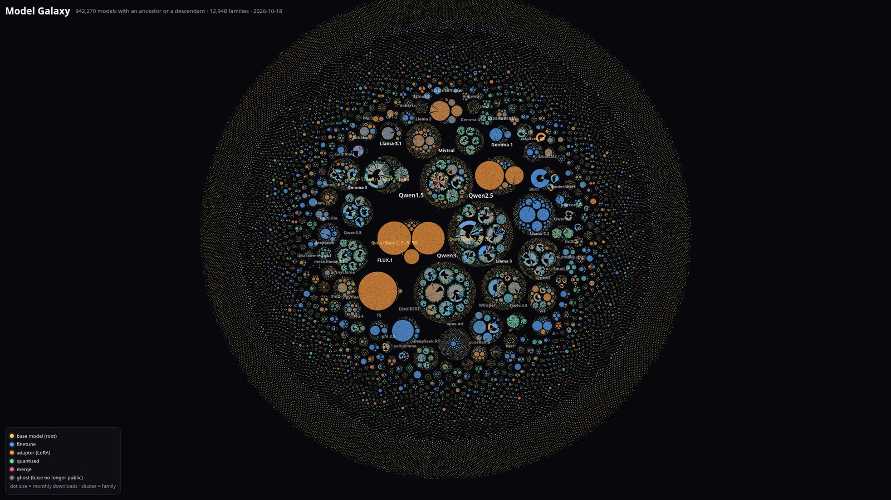
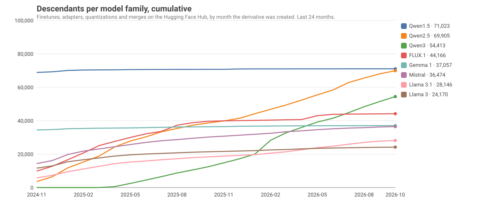
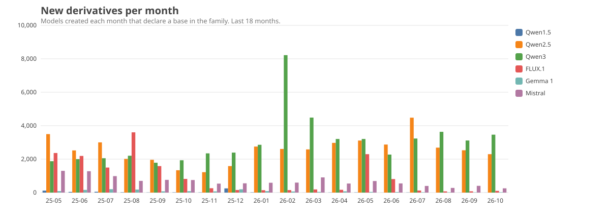

<div align="center">

<a href="https://h9-tec.github.io/model-family-tree/galaxy.html"></a>

**[Fly through the Model Galaxy →](https://h9-tec.github.io/model-family-tree/galaxy.html)** · 950,894 models in one zoomable WebGL map · **[Explorer →](https://h9-tec.github.io/model-family-tree/)** · search any model, walk its pedigree, share a link.

# Open Model Family Tree

**Every model on the Hugging Face Hub, its ancestry, and a leaderboard of the base models the ecosystem actually builds on. Rebuilt nightly.**


[](https://github.com/h9-tec/model-family-tree/stargazers)
[](LICENSE)

</div>

**3,182,810** models · **905,466** declare a base model (28%) · **938,425** parent links · **89,177** models have descendants · **45,389** roots in **24,232** families

The most built-on model on the Hub is **[black-forest-labs/FLUX.1-dev](https://huggingface.co/black-forest-labs/FLUX.1-dev)** with **43,705** descendants. In the last 90 days it is **[Qwen/Qwen3.8-27B](https://huggingface.co/Qwen/Qwen3.8-27B)** with **4,894** new ones. The biggest family is **Qwen1.5** (71,023).

## Install into your agent

```bash
claude plugin marketplace add h9-tec/model-family-tree
claude plugin install model-family-tree@model-family-tree
```

Requires [uv](https://docs.astral.sh/uv/) on PATH. Then ask Claude: *what is unsloth/Qwen2.5-7B-Instruct based on, and which Qwen base has the most finetunes?* It answers from the `lineage` and `leaderboard` MCP tools.

<details>
<summary>Any MCP client</summary>

```json
{"mcpServers": {"model-family-tree": {"command": "uv", "args": ["run", "--frozen", "--no-dev", "--directory", "/path/to/model-family-tree", "python", "mcp/server.py"]}}}
```

Tools: `lineage(id)`, `children(id)`, `leaderboard(kind)`, `family(name)`, `search(query)`.

</details>

## See it

| | |
|---|---|
| **[Galaxy](https://h9-tec.github.io/model-family-tree/galaxy.html)** | Every model that has an ancestor or a descendant (950,894 points) in one WebGL map. Families are circle-packed clusters, base models are stars, each derivative is a dot colored by relation and sized by downloads. Scroll to zoom from the whole Hub down to one model, click any dot. |
| **[Explorer](https://h9-tec.github.io/model-family-tree/)** | Type any model id. Its pedigree is drawn as a radial tree: every ancestor path fans out to the left (merges show all parents), the most downloaded descendants to the right, unfoldable level by level, live from the Hub. |
| **[Leaderboard](https://h9-tec.github.io/model-family-tree/#board:all)** | All 89,177 models with descendants, sortable and filterable, plus the curated views below. |

<a href="assets/families.svg"></a>

## Most-descended base models

Unique descendants of every kind: finetunes, adapters (LoRA), quantizations and merges, each counted once however many paths reach it. † marks a base that was deleted or made private but is still referenced. [Full top 500 →](docs/tables/models_all_time.md)

| # | Model | Descendants | Direct | Last 90d | Finetune / adapter / quantized / merge | Family |
|---:|---|---:|---:|---:|---|---|
| 1 | [black-forest-labs/FLUX.1-dev](https://huggingface.co/black-forest-labs/FLUX.1-dev) | 43,705 | 43,431 | 227 | 678 / 42,878 / 133 / 16 | FLUX.1 |
| 2 | [Qwen/Qwen1.5-0.5B](https://huggingface.co/Qwen/Qwen1.5-0.5B) | 32,564 | 32,534 | 0 | 41 / 32,475 / 46 / 2 | Qwen1.5 |
| 3 | [Qwen/Qwen1.5-1.8B](https://huggingface.co/Qwen/Qwen1.5-1.8B) | 30,657 | 30,627 | 1 | 35 / 30,591 / 29 / 2 | Qwen1.5 |
| 4 | [google/gemma-2b](https://huggingface.co/google/gemma-2b) | 24,115 | 24,035 | 10 | 309 / 23,706 / 89 / 11 | Gemma 1 |
| 5 | [Qwen/Qwen2.5-7B](https://huggingface.co/Qwen/Qwen2.5-7B) | 22,859 | 2,087 | 2,604 | 11,862 / 6,890 / 3,514 / 593 | Qwen2.5 |
| 6 | [meta-llama/Llama-3.1-8B](https://huggingface.co/meta-llama/Llama-3.1-8B) | 21,581 | 3,268 | 2,354 | 9,558 / 6,075 / 5,104 / 844 | Llama 3.1 |
| 7 | [meta-llama/Llama-3.1-8B-Instruct](https://huggingface.co/meta-llama/Llama-3.1-8B-Instruct) | 15,165 | 7,298 | 1,636 | 6,859 / 4,005 / 3,588 / 713 | Llama 3.1 |
| 8 | [Qwen/Qwen2.5-7B-Instruct](https://huggingface.co/Qwen/Qwen2.5-7B-Instruct) | 14,439 | 6,657 | 2,011 | 8,371 / 3,871 / 1,788 / 409 | Qwen2.5 |
| 9 | [distilbert/distilbert-base-uncased](https://huggingface.co/distilbert/distilbert-base-uncased) | 13,654 | 13,272 | 804 | 13,105 / 397 / 151 / 1 | DistilBERT |
| 10 | [mistralai/Mistral-7B-v0.1](https://huggingface.co/mistralai/Mistral-7B-v0.1) | 11,602 | 4,012 | 68 | 2,973 / 5,189 / 2,060 / 1,365 | Mistral |
| 11 | [stabilityai/stable-diffusion-xl-base-1.0](https://huggingface.co/stabilityai/stable-diffusion-xl-base-1.0) | 11,515 | 11,037 | 185 | 1,417 / 9,995 / 50 / 53 | Stable Diffusion |
| 12 | [Qwen/Qwen3-4B-Instruct-2507](https://huggingface.co/Qwen/Qwen3-4B-Instruct-2507) | 11,117 | 8,857 | 1,490 | 3,436 / 6,521 / 1,067 / 93 | Qwen3 |
| 13 | [Qwen/Qwen2.5-1.5B](https://huggingface.co/Qwen/Qwen2.5-1.5B) | 10,942 | 1,040 | 1,698 | 4,979 / 4,100 / 1,706 / 157 | Qwen2.5 |
| 14 | [meta-llama/Meta-Llama-3-8B](https://huggingface.co/meta-llama/Meta-Llama-3-8B) | 10,278 | 1,728 | 107 | 4,207 / 2,072 / 3,013 / 986 | Llama 3 |
| 15 | [google/gemma-7b](https://huggingface.co/google/gemma-7b) | 9,854 | 9,586 | 5 | 455 / 9,294 / 97 / 8 | Gemma 1 |
| 16 | [HuggingFaceTB/SmolLM2-360M](https://huggingface.co/HuggingFaceTB/SmolLM2-360M) | 9,846 | 193 | 1,785 | 8,876 / 611 / 354 / 5 | SmolLM2 |
| 17 | [Qwen/Qwen2.5-0.5B](https://huggingface.co/Qwen/Qwen2.5-0.5B) | 9,587 | 1,373 | 942 | 5,990 / 2,227 / 1,314 / 56 | Qwen2.5 |
| 18 | [Qwen/Qwen3-8B-Base](https://huggingface.co/Qwen/Qwen3-8B-Base) | 9,478 | 852 | 1,829 | 4,715 / 2,897 / 1,793 / 72 | Qwen3 |
| 19 | [HuggingFaceTB/SmolLM2-360M-Instruct](https://huggingface.co/HuggingFaceTB/SmolLM2-360M-Instruct) | 9,387 | 393 | 1,750 | 8,721 / 380 / 281 / 5 | SmolLM2 |
| 20 | [HuggingFaceTB/SmolVLM-500M-Instruct](https://huggingface.co/HuggingFaceTB/SmolVLM-500M-Instruct) | 8,691 | 92 | 1,640 | 8,477 / 148 / 66 / 0 | SmolLM2 |
| 21 | [Qwen/Qwen2.5-3B](https://huggingface.co/Qwen/Qwen2.5-3B) | 8,612 | 1,135 | 1,350 | 3,875 / 3,128 / 1,524 / 85 | Qwen2.5 |
| 22 | [HuggingFaceTB/SmolVLM2-500M-Video-Instruct](https://huggingface.co/HuggingFaceTB/SmolVLM2-500M-Video-Instruct) | 8,590 | 129 | 1,620 | 8,443 / 117 / 30 / 0 | SmolLM2 |
| 23 | [lerobot/smolvla_base](https://huggingface.co/lerobot/smolvla_base) | 8,457 | 8,410 | 1,601 | 8,351 / 100 / 6 / 0 | SmolLM2 |
| 24 | [Qwen/Qwen3-8B](https://huggingface.co/Qwen/Qwen3-8B) | 7,894 | 5,092 | 1,444 | 3,671 / 2,682 / 1,472 / 68 | Qwen3 |
| 25 | [meta-llama/Llama-3.2-3B-Instruct](https://huggingface.co/meta-llama/Llama-3.2-3B-Instruct) | 7,532 | 3,481 | 640 | 3,937 / 1,591 / 1,852 / 152 | Llama 3.2 |

## Hot right now: new descendants in the last 90 days

[Full top 500 →](docs/tables/models_90d.md)

| # | Model | Descendants | Direct | Last 90d | Finetune / adapter / quantized / merge | Family |
|---:|---|---:|---:|---:|---|---|
| 1 | [Qwen/Qwen3.8-27B](https://huggingface.co/Qwen/Qwen3.8-27B) | 4,897 | 2,547 | 4,894 | 1,025 / 385 / 3,429 / 58 | Qwen3.8 |
| 2 | [Qwen/Qwen3.5-9B-Base](https://huggingface.co/Qwen/Qwen3.5-9B-Base) | 6,279 | 769 | 3,270 | 2,459 / 1,439 / 2,275 / 106 | Qwen3.5 |
| 3 | [Qwen/Qwen3.5-4B-Base](https://huggingface.co/Qwen/Qwen3.5-4B-Base) | 4,843 | 398 | 2,669 | 1,913 / 1,305 / 1,584 / 41 | Qwen3.5 |
| 4 | [Qwen/Qwen2.5-7B](https://huggingface.co/Qwen/Qwen2.5-7B) | 22,859 | 2,087 | 2,604 | 11,862 / 6,890 / 3,514 / 593 | Qwen2.5 |
| 5 | [Qwen/Qwen3.5-9B](https://huggingface.co/Qwen/Qwen3.5-9B) | 5,157 | 2,783 | 2,587 | 1,674 / 1,334 / 2,046 / 103 | Qwen3.5 |
| 6 | [meta-llama/Llama-3.1-8B](https://huggingface.co/meta-llama/Llama-3.1-8B) | 21,581 | 3,268 | 2,354 | 9,558 / 6,075 / 5,104 / 844 | Llama 3.1 |
| 7 | [Qwen/Qwen3.5-4B](https://huggingface.co/Qwen/Qwen3.5-4B) | 4,254 | 2,505 | 2,283 | 1,595 / 1,165 / 1,458 / 36 | Qwen3.5 |
| 8 | [Qwen/Qwen2.5-7B-Instruct](https://huggingface.co/Qwen/Qwen2.5-7B-Instruct) | 14,439 | 6,657 | 2,011 | 8,371 / 3,871 / 1,788 / 409 | Qwen2.5 |
| 9 | [Qwen/Qwen3-8B-Base](https://huggingface.co/Qwen/Qwen3-8B-Base) | 9,478 | 852 | 1,829 | 4,715 / 2,897 / 1,793 / 72 | Qwen3 |
| 10 | [HuggingFaceTB/SmolLM2-360M](https://huggingface.co/HuggingFaceTB/SmolLM2-360M) | 9,846 | 193 | 1,785 | 8,876 / 611 / 354 / 5 | SmolLM2 |
| 11 | [HuggingFaceTB/SmolLM2-360M-Instruct](https://huggingface.co/HuggingFaceTB/SmolLM2-360M-Instruct) | 9,387 | 393 | 1,750 | 8,721 / 380 / 281 / 5 | SmolLM2 |
| 12 | [Qwen/Qwen2.5-1.5B](https://huggingface.co/Qwen/Qwen2.5-1.5B) | 10,942 | 1,040 | 1,698 | 4,979 / 4,100 / 1,706 / 157 | Qwen2.5 |
| 13 | [HuggingFaceTB/SmolVLM-500M-Instruct](https://huggingface.co/HuggingFaceTB/SmolVLM-500M-Instruct) | 8,691 | 92 | 1,640 | 8,477 / 148 / 66 / 0 | SmolLM2 |
| 14 | [meta-llama/Llama-3.1-8B-Instruct](https://huggingface.co/meta-llama/Llama-3.1-8B-Instruct) | 15,165 | 7,298 | 1,636 | 6,859 / 4,005 / 3,588 / 713 | Llama 3.1 |
| 15 | [Qwen/Qwen3-0.6B-Base](https://huggingface.co/Qwen/Qwen3-0.6B-Base) | 6,584 | 926 | 1,620 | 3,809 / 1,002 / 1,748 / 25 | Qwen3 |
| 16 | [HuggingFaceTB/SmolVLM2-500M-Video-Instruct](https://huggingface.co/HuggingFaceTB/SmolVLM2-500M-Video-Instruct) | 8,590 | 129 | 1,620 | 8,443 / 117 / 30 / 0 | SmolLM2 |
| 17 | [lerobot/smolvla_base](https://huggingface.co/lerobot/smolvla_base) | 8,457 | 8,410 | 1,601 | 8,351 / 100 / 6 / 0 | SmolLM2 |
| 18 | [Qwen/Qwen3-4B-Instruct-2507](https://huggingface.co/Qwen/Qwen3-4B-Instruct-2507) | 11,117 | 8,857 | 1,490 | 3,436 / 6,521 / 1,067 / 93 | Qwen3 |
| 19 | [Qwen/Qwen3-8B](https://huggingface.co/Qwen/Qwen3-8B) | 7,894 | 5,092 | 1,444 | 3,671 / 2,682 / 1,472 / 68 | Qwen3 |
| 20 | [Qwen/Qwen3.5-0.8B-Base](https://huggingface.co/Qwen/Qwen3.5-0.8B-Base) | 2,626 | 264 | 1,365 | 992 / 719 / 906 / 9 | Qwen3.5 |
| 21 | [Qwen/Qwen2.5-3B](https://huggingface.co/Qwen/Qwen2.5-3B) | 8,612 | 1,135 | 1,350 | 3,875 / 3,128 / 1,524 / 85 | Qwen2.5 |
| 22 | [krea/Krea-2-Raw](https://huggingface.co/krea/Krea-2-Raw) | 2,992 | 1,120 | 1,240 | 115 / 2,804 / 70 / 3 | krea-2-raw |
| 23 | [Qwen/Qwen3.6-35B-A3B](https://huggingface.co/Qwen/Qwen3.6-35B-A3B) | 2,914 | 1,710 | 1,204 | 511 / 491 / 1,863 / 48 | Qwen3.6 |
| 24 | [Qwen/Qwen3-4B-Base](https://huggingface.co/Qwen/Qwen3-4B-Base) | 6,758 | 704 | 1,198 | 3,408 / 1,654 / 1,603 / 93 | Qwen3 |
| 25 | [Qwen/Qwen3-1.7B-Base](https://huggingface.co/Qwen/Qwen3-1.7B-Base) | 4,925 | 613 | 1,172 | 2,750 / 1,014 / 1,141 / 20 | Qwen3 |

## Finetunes only

Adapters and quantizations inflate the all-time table (tens of thousands of auto-generated LoRAs sit on a few small bases). This view counts descendants whose own relation to their parent is `finetune`. [Full top 500 →](docs/tables/models_finetune.md)

| # | Model | Descendants | Direct | Last 90d | Finetune / adapter / quantized / merge | Family |
|---:|---|---:|---:|---:|---|---|
| 1 | [distilbert/distilbert-base-uncased](https://huggingface.co/distilbert/distilbert-base-uncased) | 13,654 | 13,272 | 804 | 13,105 / 397 / 151 / 1 | DistilBERT |
| 2 | [Qwen/Qwen2.5-7B](https://huggingface.co/Qwen/Qwen2.5-7B) | 22,859 | 2,087 | 2,604 | 11,862 / 6,890 / 3,514 / 593 | Qwen2.5 |
| 3 | [meta-llama/Llama-3.1-8B](https://huggingface.co/meta-llama/Llama-3.1-8B) | 21,581 | 3,268 | 2,354 | 9,558 / 6,075 / 5,104 / 844 | Llama 3.1 |
| 4 | [HuggingFaceTB/SmolLM2-360M](https://huggingface.co/HuggingFaceTB/SmolLM2-360M) | 9,846 | 193 | 1,785 | 8,876 / 611 / 354 / 5 | SmolLM2 |
| 5 | [HuggingFaceTB/SmolLM2-360M-Instruct](https://huggingface.co/HuggingFaceTB/SmolLM2-360M-Instruct) | 9,387 | 393 | 1,750 | 8,721 / 380 / 281 / 5 | SmolLM2 |
| 6 | [HuggingFaceTB/SmolVLM-500M-Instruct](https://huggingface.co/HuggingFaceTB/SmolVLM-500M-Instruct) | 8,691 | 92 | 1,640 | 8,477 / 148 / 66 / 0 | SmolLM2 |
| 7 | [HuggingFaceTB/SmolVLM2-500M-Video-Instruct](https://huggingface.co/HuggingFaceTB/SmolVLM2-500M-Video-Instruct) | 8,590 | 129 | 1,620 | 8,443 / 117 / 30 / 0 | SmolLM2 |
| 8 | [Qwen/Qwen2.5-7B-Instruct](https://huggingface.co/Qwen/Qwen2.5-7B-Instruct) | 14,439 | 6,657 | 2,011 | 8,371 / 3,871 / 1,788 / 409 | Qwen2.5 |
| 9 | [lerobot/smolvla_base](https://huggingface.co/lerobot/smolvla_base) | 8,457 | 8,410 | 1,601 | 8,351 / 100 / 6 / 0 | SmolLM2 |
| 10 | [google-bert/bert-base-uncased](https://huggingface.co/google-bert/bert-base-uncased) | 7,463 | 7,220 | 262 | 7,235 / 147 / 74 / 7 | BERT |
| 11 | [meta-llama/Llama-3.1-8B-Instruct](https://huggingface.co/meta-llama/Llama-3.1-8B-Instruct) | 15,165 | 7,298 | 1,636 | 6,859 / 4,005 / 3,588 / 713 | Llama 3.1 |
| 12 | [Qwen/Qwen2.5-0.5B](https://huggingface.co/Qwen/Qwen2.5-0.5B) | 9,587 | 1,373 | 942 | 5,990 / 2,227 / 1,314 / 56 | Qwen2.5 |
| 13 | [Qwen/Qwen2.5-1.5B](https://huggingface.co/Qwen/Qwen2.5-1.5B) | 10,942 | 1,040 | 1,698 | 4,979 / 4,100 / 1,706 / 157 | Qwen2.5 |
| 14 | [Qwen/Qwen3-8B-Base](https://huggingface.co/Qwen/Qwen3-8B-Base) | 9,478 | 852 | 1,829 | 4,715 / 2,897 / 1,793 / 72 | Qwen3 |
| 15 | [unsloth/Qwen2.5-7B-Instruct](https://huggingface.co/unsloth/Qwen2.5-7B-Instruct) | 5,353 | 5,311 | 677 | 4,549 / 773 / 29 / 2 | Qwen2.5 |
| 16 | [FacebookAI/xlm-roberta-base](https://huggingface.co/FacebookAI/xlm-roberta-base) | 4,741 | 4,378 | 200 | 4,545 / 79 / 116 / 0 | XLM-RoBERTa |
| 17 | [google/gemma-3-4b-pt](https://huggingface.co/google/gemma-3-4b-pt) | 6,689 | 395 | 541 | 4,527 / 944 / 1,202 / 16 | Gemma 3 |
| 18 | [meta-llama/Meta-Llama-3-8B](https://huggingface.co/meta-llama/Meta-Llama-3-8B) | 10,278 | 1,728 | 107 | 4,207 / 2,072 / 3,013 / 986 | Llama 3 |
| 19 | [aubmindlab/bert-base-arabertv02](https://huggingface.co/aubmindlab/bert-base-arabertv02) | 4,115 | 4,058 | 16 | 4,106 / 5 / 4 / 0 | BERT |
| 20 | [openai/whisper-small](https://huggingface.co/openai/whisper-small) | 4,738 | 4,411 | 358 | 4,071 / 349 / 318 / 0 | Whisper |
| 21 | [meta-llama/Llama-3.2-3B-Instruct](https://huggingface.co/meta-llama/Llama-3.2-3B-Instruct) | 7,532 | 3,481 | 640 | 3,937 / 1,591 / 1,852 / 152 | Llama 3.2 |
| 22 | [Qwen/Qwen2.5-3B](https://huggingface.co/Qwen/Qwen2.5-3B) | 8,612 | 1,135 | 1,350 | 3,875 / 3,128 / 1,524 / 85 | Qwen2.5 |
| 23 | [Qwen/Qwen3-0.6B-Base](https://huggingface.co/Qwen/Qwen3-0.6B-Base) | 6,584 | 926 | 1,620 | 3,809 / 1,002 / 1,748 / 25 | Qwen3 |
| 24 | [Qwen/Qwen3-8B](https://huggingface.co/Qwen/Qwen3-8B) | 7,894 | 5,092 | 1,444 | 3,671 / 2,682 / 1,472 / 68 | Qwen3 |
| 25 | [Qwen/Qwen3-4B-Instruct-2507](https://huggingface.co/Qwen/Qwen3-4B-Instruct-2507) | 11,117 | 8,857 | 1,490 | 3,436 / 6,521 / 1,067 / 93 | Qwen3 |

## Families

Roots grouped by series name across organizations (so `unsloth/Llama-3.1-8B` re-uploads count toward Llama 3.1). Grouping is a heuristic with hand overrides in [`data/families.yaml`](data/families.yaml); PRs welcome. [Full table →](docs/tables/families.md)

<a href="assets/monthly.svg"></a>

| # | Family | Descendants | Last 90d | Roots | Finetune / adapter / quantized / merge | Biggest root |
|---:|---|---:|---:|---:|---|---|
| 1 | **Qwen1.5** | 71,023 | 7 | 44 | 224 / 70,434 / 349 / 16 | [Qwen/Qwen1.5-0.5B](https://huggingface.co/Qwen/Qwen1.5-0.5B) |
| 2 | **Qwen2.5** | 70,103 | 7,737 | 687 | 33,875 / 19,976 / 14,630 / 1,622 | [Qwen/Qwen2.5-7B](https://huggingface.co/Qwen/Qwen2.5-7B) |
| 3 | **Qwen3** | 54,564 | 10,413 | 646 | 24,187 / 17,063 / 12,876 / 436 | [Qwen/Qwen3-4B-Instruct-2507](https://huggingface.co/Qwen/Qwen3-4B-Instruct-2507) |
| 4 | **FLUX.1** | 44,166 | 258 | 16 | 769 / 43,183 / 197 / 17 | [black-forest-labs/FLUX.1-dev](https://huggingface.co/black-forest-labs/FLUX.1-dev) |
| 5 | **Gemma 1** | 37,064 | 59 | 184 | 1,755 / 34,354 / 887 / 68 | [google/gemma-2b](https://huggingface.co/google/gemma-2b) |
| 6 | **Mistral** | 36,487 | 975 | 582 | 10,626 / 11,243 / 11,671 / 2,931 | [mistralai/Mistral-7B-v0.1](https://huggingface.co/mistralai/Mistral-7B-v0.1) |
| 7 | **Llama 3.1** | 28,169 | 2,566 | 222 | 11,085 / 6,961 / 8,183 / 1,940 | [meta-llama/Llama-3.1-8B](https://huggingface.co/meta-llama/Llama-3.1-8B) |
| 8 | **Llama 3** | 24,184 | 406 | 544 | 8,084 / 5,863 / 7,776 / 2,461 | [meta-llama/Meta-Llama-3-8B](https://huggingface.co/meta-llama/Meta-Llama-3-8B) |
| 9 | **BERT** | 23,214 | 608 | 304 | 22,439 / 508 / 259 / 8 | [google-bert/bert-base-uncased](https://huggingface.co/google-bert/bert-base-uncased) |
| 10 | **Llama 3.2** | 21,100 | 1,431 | 478 | 9,700 / 5,716 / 5,090 / 594 | [meta-llama/Llama-3.2-3B-Instruct](https://huggingface.co/meta-llama/Llama-3.2-3B-Instruct) |
| 11 | **Qwen3.5** | 19,693 | 9,214 | 145 | 7,464 / 4,379 / 7,637 / 212 | [Qwen/Qwen3.5-9B-Base](https://huggingface.co/Qwen/Qwen3.5-9B-Base) |
| 12 | **Gemma 3** | 18,208 | 1,328 | 140 | 10,602 / 2,994 / 4,393 / 219 | [google/gemma-3-4b-pt](https://huggingface.co/google/gemma-3-4b-pt) |
| 13 | **Stable Diffusion** | 17,913 | 360 | 30 | 3,418 / 14,326 / 98 / 71 | [stabilityai/stable-diffusion-xl-base-1.0](https://huggingface.co/stabilityai/stable-diffusion-xl-base-1.0) |
| 14 | **Whisper** | 15,534 | 1,478 | 201 | 11,491 / 2,349 / 1,686 / 8 | [openai/whisper-small](https://huggingface.co/openai/whisper-small) |
| 15 | **DistilBERT** | 15,235 | 871 | 81 | 14,456 / 497 / 281 / 1 | [distilbert/distilbert-base-uncased](https://huggingface.co/distilbert/distilbert-base-uncased) |
| 16 | **SmolLM2** | 13,721 | 2,106 | 59 | 10,967 / 1,605 / 1,129 / 20 | [HuggingFaceTB/SmolLM2-360M](https://huggingface.co/HuggingFaceTB/SmolLM2-360M) |
| 17 | **Gemma 2** | 12,341 | 468 | 226 | 5,076 / 3,183 / 3,141 / 941 | [google/gemma-2-9b](https://huggingface.co/google/gemma-2-9b) |
| 18 | **Llama 2** | 11,632 | 282 | 413 | 2,985 / 7,067 / 1,367 / 213 | [meta-llama/Llama-2-7b-hf](https://huggingface.co/meta-llama/Llama-2-7b-hf) |
| 19 | **Gemma 4** | 11,260 | 4,019 | 130 | 3,344 / 2,036 / 5,722 / 158 | [google/gemma-4-31B](https://huggingface.co/google/gemma-4-31B) |
| 20 | **Qwen2** | 10,784 | 193 | 161 | 3,179 / 6,026 / 1,491 / 88 | [Qwen/Qwen2-0.5B](https://huggingface.co/Qwen/Qwen2-0.5B) |
| 21 | **DeepSeek-R1** | 8,913 | 422 | 131 | 2,722 / 1,517 / 3,782 / 892 | [deepseek-ai/DeepSeek-R1-Distill-Qwen-1.5B](https://huggingface.co/deepseek-ai/DeepSeek-R1-Distill-Qwen-1.5B) |
| 22 | **XLM-RoBERTa** | 6,343 | 326 | 49 | 6,028 / 138 / 176 / 0 | [FacebookAI/xlm-roberta-base](https://huggingface.co/FacebookAI/xlm-roberta-base) |
| 23 | **Qwen3.8** | 6,130 | 6,126 | 59 | 1,202 / 396 / 4,459 / 73 | [Qwen/Qwen3.8-27B](https://huggingface.co/Qwen/Qwen3.8-27B) |
| 24 | **ViT** | 6,083 | 183 | 66 | 5,198 / 752 / 133 / 0 | [google/vit-base-patch16-224-in21k](https://huggingface.co/google/vit-base-patch16-224-in21k) |
| 25 | **Qwen3.6** | 5,965 | 2,148 | 52 | 1,121 / 1,133 / 3,612 / 92 | [Qwen/Qwen3.6-35B-A3B](https://huggingface.co/Qwen/Qwen3.6-35B-A3B) |

## Organizations

Descendants of every root owned by the organization, deduplicated. [Full table →](docs/tables/orgs.md)

| # | Organization | Descendants of its roots | Last 90d | Roots | Biggest root |
|---:|---|---:|---:|---:|---|
| 1 | [Qwen](https://huggingface.co/Qwen) | 236,131 | 36,552 | 148 | [Qwen/Qwen1.5-0.5B](https://huggingface.co/Qwen/Qwen1.5-0.5B) |
| 2 | [google](https://huggingface.co/google) | 92,008 | 7,447 | 326 | [google/gemma-2b](https://huggingface.co/google/gemma-2b) |
| 3 | [meta-llama](https://huggingface.co/meta-llama) | 68,802 | 4,506 | 50 | [meta-llama/Llama-3.1-8B](https://huggingface.co/meta-llama/Llama-3.1-8B) |
| 4 | [black-forest-labs](https://huggingface.co/black-forest-labs) | 46,139 | 744 | 20 | [black-forest-labs/FLUX.1-dev](https://huggingface.co/black-forest-labs/FLUX.1-dev) |
| 5 | [mistralai](https://huggingface.co/mistralai) | 32,789 | 1,347 | 32 | [mistralai/Mistral-7B-v0.1](https://huggingface.co/mistralai/Mistral-7B-v0.1) |
| 6 | [unsloth](https://huggingface.co/unsloth) | 24,216 | 379 | 269 | [unsloth/llama-3-8b-Instruct-bnb-4bit](https://huggingface.co/unsloth/llama-3-8b-Instruct-bnb-4bit) |
| 7 | [microsoft](https://huggingface.co/microsoft) | 22,360 | 1,253 | 255 | [microsoft/Phi-3-mini-4k-instruct](https://huggingface.co/microsoft/Phi-3-mini-4k-instruct) |
| 8 | [openai](https://huggingface.co/openai) | 19,243 | 1,822 | 21 | [openai/whisper-small](https://huggingface.co/openai/whisper-small) |
| 9 | [facebook](https://huggingface.co/facebook) | 17,745 | 1,357 | 496 | [facebook/wav2vec2-base](https://huggingface.co/facebook/wav2vec2-base) |
| 10 | [distilbert](https://huggingface.co/distilbert) | 17,563 | 981 | 9 | [distilbert/distilbert-base-uncased](https://huggingface.co/distilbert/distilbert-base-uncased) |
| 11 | [HuggingFaceTB](https://huggingface.co/HuggingFaceTB) | 16,315 | 2,251 | 29 | [HuggingFaceTB/SmolLM2-360M](https://huggingface.co/HuggingFaceTB/SmolLM2-360M) |
| 12 | [stabilityai](https://huggingface.co/stabilityai) | 15,237 | 276 | 73 | [stabilityai/stable-diffusion-xl-base-1.0](https://huggingface.co/stabilityai/stable-diffusion-xl-base-1.0) |
| 13 | [google-bert](https://huggingface.co/google-bert) | 14,697 | 369 | 12 | [google-bert/bert-base-uncased](https://huggingface.co/google-bert/bert-base-uncased) |
| 14 | [deepseek-ai](https://huggingface.co/deepseek-ai) | 14,282 | 1,528 | 77 | [deepseek-ai/DeepSeek-R1-Distill-Qwen-1.5B](https://huggingface.co/deepseek-ai/DeepSeek-R1-Distill-Qwen-1.5B) |
| 15 | [FacebookAI](https://huggingface.co/FacebookAI) | 9,938 | 483 | 19 | [FacebookAI/xlm-roberta-base](https://huggingface.co/FacebookAI/xlm-roberta-base) |

## How it works

1. **Source.** The daily [`cfahlgren1/hub-stats`](https://huggingface.co/datasets/cfahlgren1/hub-stats) dump of the Hub's `/api/models` (Apache-2.0), which carries the `base_model` metadata model authors declare in their cards, plus the legacy `base_model:` tags as a fallback.
2. **Graph.** Child → parent edges with the declared relation (`finetune`, `adapter`, `quantized`, `merge`). Merges give a DAG, mis-tagged cards give the occasional cycle (78 nodes today); both are handled.
3. **Counts.** Descendant sets are built children-first and unioned, so every model is counted once per ancestor. `direct` is declared children; `total` is the whole subtree.
4. **Families.** Roots (models that declare no parent) are grouped by a series heuristic over the model name, with overrides in `data/families.yaml`.
5. **Galaxy layout.** Each root's subtree is a radial tree (depth rings sized by population, wedges by subtree size); roots are circle-packed inside their family and families into the galaxy, with a port of d3's front-chain packing. Positions ship as a 10 MB binary, ids load lazily in chunks.
6. **Refresh.** A GitHub Action rebuilds everything nightly, commits `dist/` and `README.md`, and attaches the full node and edge tables plus the galaxy data to the [`data-latest`](https://github.com/h9-tec/model-family-tree/releases/tag/data-latest) release, which the site reads.

### Caveats

- **Declared ancestry only.** 28% of models declare a base. Untagged re-uploads and GGUF conversions without metadata are invisible, so every number is a floor.
- **Activity, not quality.** A base with 30,000 adapters was mostly a tutorial default. Read the finetune-only and 90-day tables alongside the all-time one.
- **Ghost parents.** 4,061 referenced bases are no longer public. They stay in the tree, marked †.
- **Families are heuristic.** Series detection is a regex over names. Fix a wrong grouping by editing `data/families.yaml`.

## Data files

| File | What |
|---|---|
| [`dist/leaderboard.json`](dist/leaderboard.json) | Top 500 models (all time, 90 days, finetune-only), families, organizations |
| [`dist/parents.json`](dist/parents.json) | Every model with descendants, compact columns |
| [`dist/timeseries.json`](dist/timeseries.json) | Monthly new descendants for the top families and models |
| [`dist/children_top.json`](dist/children_top.json) | Top 25 children by downloads for the 3,000 most-descended parents |
| [`dist/llms.txt`](dist/llms.txt) | Plain-text summary for LLMs |
| `data-latest` release | `nodes.parquet` and `edges.parquet`, the full graph |

## Build it yourself

```bash
uv sync
uv run python scripts/build.py all        # downloads the dump (~1.6 GB), builds in about 15 seconds
uv run python scripts/build.py build      # rebuild from the cached dump
uv run pytest
```

## Related

- [Arabic AI Atlas](https://github.com/h9-tec/arabic-ai-atlas): the same idea for one language's ecosystem, with a map.
- Hugging Face shows the tree for one model on its page; this repo aggregates the whole Hub.

## License

Code MIT. Generated data CC BY 4.0, derived from Hub metadata via `cfahlgren1/hub-stats` (Apache-2.0).

*Generated 2026-10-25.*
