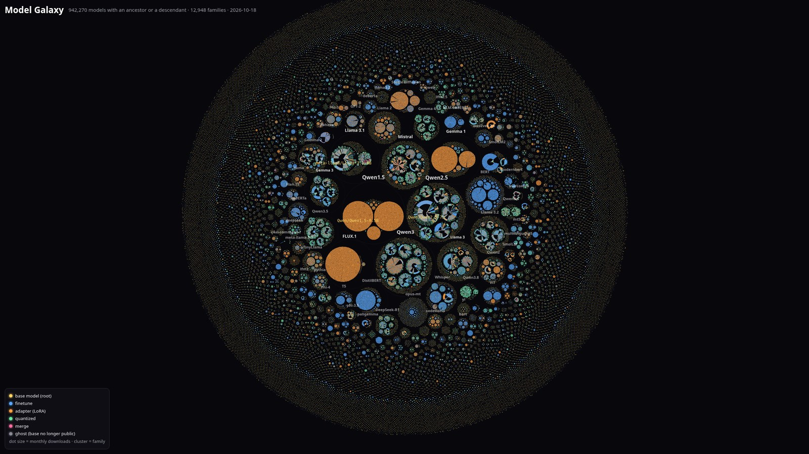
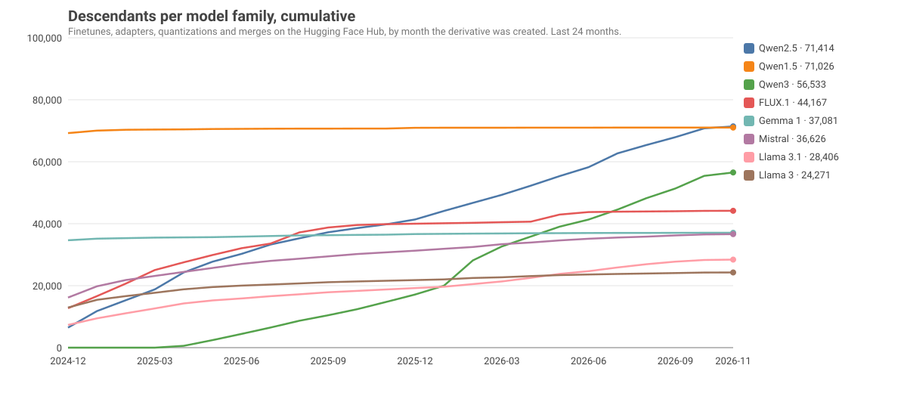
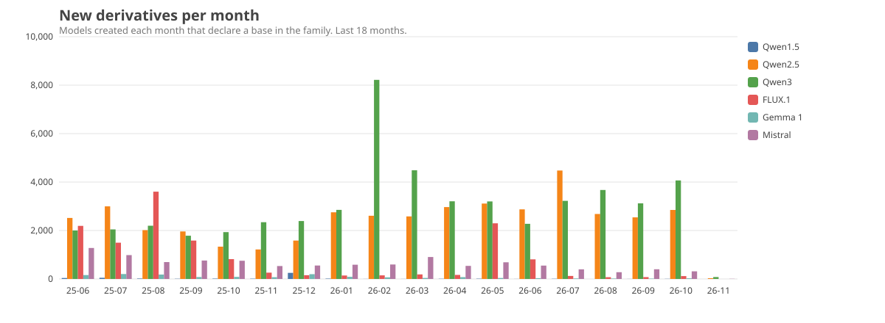

<div align="center">

<a href="https://h9-tec.github.io/model-family-tree/galaxy.html"></a>

**[Fly through the Model Galaxy →](https://h9-tec.github.io/model-family-tree/galaxy.html)** · 977,098 models in one zoomable WebGL map · **[Explorer →](https://h9-tec.github.io/model-family-tree/)** · search any model, walk its pedigree, share a link.

# Open Model Family Tree

**Every model on the Hugging Face Hub, its ancestry, and a leaderboard of the base models the ecosystem actually builds on. Rebuilt nightly.**


[](https://github.com/h9-tec/model-family-tree/stargazers)
[](LICENSE)

</div>

**3,234,964** models · **930,587** declare a base model (29%) · **963,914** parent links · **92,258** models have descendants · **46,473** roots in **24,877** families

The most built-on model on the Hub is **[black-forest-labs/FLUX.1-dev](https://huggingface.co/black-forest-labs/FLUX.1-dev)** with **43,702** descendants. In the last 90 days it is **[Qwen/Qwen3.8-27B](https://huggingface.co/Qwen/Qwen3.8-27B)** with **5,497** new ones. The biggest family is **Qwen2.5** (71,971).

## Install into your agent

```bash
claude plugin marketplace add h9-tec/model-family-tree
claude plugin install model-family-tree@model-family-tree
```

Requires [uv](https://docs.astral.sh/uv/) on PATH. Then ask Claude: *what is unsloth/Qwen2.5-7B-Instruct based on, and which Qwen base has the most finetunes?* It answers from the `lineage` and `leaderboard` MCP tools.

<details>
<summary>Any MCP client</summary>

```json
{"mcpServers": {"model-family-tree": {"command": "uv", "args": ["run", "--frozen", "--no-dev", "--directory", "/path/to/model-family-tree", "python", "mcp/server.py"]}}}
```

Tools: `lineage(id)`, `children(id)`, `leaderboard(kind)`, `family(name)`, `search(query)`.

</details>

## See it

| | |
|---|---|
| **[Galaxy](https://h9-tec.github.io/model-family-tree/galaxy.html)** | Every model that has an ancestor or a descendant (977,098 points) in one WebGL map. Families are circle-packed clusters, base models are stars, each derivative is a dot colored by relation and sized by downloads. Scroll to zoom from the whole Hub down to one model, click any dot. |
| **[Explorer](https://h9-tec.github.io/model-family-tree/)** | Type any model id. Its pedigree is drawn as a radial tree: every ancestor path fans out to the left (merges show all parents), the most downloaded descendants to the right, unfoldable level by level, live from the Hub. |
| **[Leaderboard](https://h9-tec.github.io/model-family-tree/#board:all)** | All 92,258 models with descendants, sortable and filterable, plus the curated views below. |

<a href="assets/families.svg"></a>

## Most-descended base models

Unique descendants of every kind: finetunes, adapters (LoRA), quantizations and merges, each counted once however many paths reach it. † marks a base that was deleted or made private but is still referenced. [Full top 500 →](docs/tables/models_all_time.md)

| # | Model | Descendants | Direct | Last 90d | Finetune / adapter / quantized / merge | Family |
|---:|---|---:|---:|---:|---|---|
| 1 | [black-forest-labs/FLUX.1-dev](https://huggingface.co/black-forest-labs/FLUX.1-dev) | 43,702 | 43,425 | 217 | 694 / 42,856 / 136 / 16 | FLUX.1 |
| 2 | [Qwen/Qwen1.5-0.5B](https://huggingface.co/Qwen/Qwen1.5-0.5B) | 32,562 | 32,534 | 0 | 40 / 32,475 / 45 / 2 | Qwen1.5 |
| 3 | [Qwen/Qwen1.5-1.8B](https://huggingface.co/Qwen/Qwen1.5-1.8B) | 30,658 | 30,628 | 2 | 36 / 30,591 / 29 / 2 | Qwen1.5 |
| 4 | [google/gemma-2b](https://huggingface.co/google/gemma-2b) | 24,117 | 24,037 | 7 | 311 / 23,706 / 89 / 11 | Gemma 1 |
| 5 | [Qwen/Qwen2.5-7B](https://huggingface.co/Qwen/Qwen2.5-7B) | 23,413 | 2,105 | 2,510 | 12,225 / 7,026 / 3,571 / 591 | Qwen2.5 |
| 6 | [meta-llama/Llama-3.1-8B](https://huggingface.co/meta-llama/Llama-3.1-8B) | 21,837 | 3,277 | 1,906 | 9,648 / 6,183 / 5,157 / 849 | Llama 3.1 |
| 7 | [meta-llama/Llama-3.1-8B-Instruct](https://huggingface.co/meta-llama/Llama-3.1-8B-Instruct) | 15,388 | 7,435 | 1,447 | 6,943 / 4,106 / 3,621 / 718 | Llama 3.1 |
| 8 | [Qwen/Qwen2.5-7B-Instruct](https://huggingface.co/Qwen/Qwen2.5-7B-Instruct) | 14,892 | 6,810 | 1,899 | 8,680 / 3,983 / 1,820 / 409 | Qwen2.5 |
| 9 | [distilbert/distilbert-base-uncased](https://huggingface.co/distilbert/distilbert-base-uncased) | 13,757 | 13,375 | 718 | 13,203 / 399 / 154 / 1 | DistilBERT |
| 10 | [mistralai/Mistral-7B-v0.1](https://huggingface.co/mistralai/Mistral-7B-v0.1) | 11,637 | 4,013 | 88 | 3,004 / 5,185 / 2,068 / 1,365 | Mistral |
| 11 | [stabilityai/stable-diffusion-xl-base-1.0](https://huggingface.co/stabilityai/stable-diffusion-xl-base-1.0) | 11,571 | 11,086 | 227 | 1,424 / 10,039 / 54 / 54 | Stable Diffusion |
| 12 | [Qwen/Qwen2.5-1.5B](https://huggingface.co/Qwen/Qwen2.5-1.5B) | 11,399 | 1,088 | 1,853 | 5,152 / 4,286 / 1,797 / 164 | Qwen2.5 |
| 13 | [Qwen/Qwen3-4B-Instruct-2507](https://huggingface.co/Qwen/Qwen3-4B-Instruct-2507) | 11,389 | 9,048 | 1,708 | 3,606 / 6,556 / 1,135 / 92 | Qwen3 |
| 14 | [meta-llama/Meta-Llama-3-8B](https://huggingface.co/meta-llama/Meta-Llama-3-8B) | 10,322 | 1,731 | 101 | 4,246 / 2,073 / 3,014 / 989 | Llama 3 |
| 15 | [HuggingFaceTB/SmolLM2-360M](https://huggingface.co/HuggingFaceTB/SmolLM2-360M) | 10,058 | 205 | 1,610 | 9,055 / 635 / 363 / 5 | SmolLM2 |
| 16 | [Qwen/Qwen3-8B-Base](https://huggingface.co/Qwen/Qwen3-8B-Base) | 10,052 | 910 | 2,098 | 5,013 / 3,085 / 1,880 / 73 | Qwen3 |
| 17 | [Qwen/Qwen2.5-0.5B](https://huggingface.co/Qwen/Qwen2.5-0.5B) | 10,033 | 1,481 | 1,262 | 6,199 / 2,391 / 1,383 / 60 | Qwen2.5 |
| 18 | [google/gemma-7b](https://huggingface.co/google/gemma-7b) | 9,858 | 9,588 | 6 | 457 / 9,296 / 97 / 8 | Gemma 1 |
| 19 | [HuggingFaceTB/SmolLM2-360M-Instruct](https://huggingface.co/HuggingFaceTB/SmolLM2-360M-Instruct) | 9,586 | 414 | 1,568 | 8,890 / 402 / 289 / 5 | SmolLM2 |
| 20 | [HuggingFaceTB/SmolVLM-500M-Instruct](https://huggingface.co/HuggingFaceTB/SmolVLM-500M-Instruct) | 8,866 | 93 | 1,438 | 8,639 / 161 / 66 / 0 | SmolLM2 |
| 21 | [Qwen/Qwen2.5-3B](https://huggingface.co/Qwen/Qwen2.5-3B) | 8,780 | 1,140 | 1,240 | 3,924 / 3,203 / 1,568 / 85 | Qwen2.5 |
| 22 | [HuggingFaceTB/SmolVLM2-500M-Video-Instruct](https://huggingface.co/HuggingFaceTB/SmolVLM2-500M-Video-Instruct) | 8,764 | 134 | 1,419 | 8,604 / 130 / 30 / 0 | SmolLM2 |
| 23 | [lerobot/smolvla_base](https://huggingface.co/lerobot/smolvla_base) | 8,626 | 8,562 | 1,401 | 8,508 / 112 / 6 / 0 | SmolLM2 |
| 24 | [Qwen/Qwen3-8B](https://huggingface.co/Qwen/Qwen3-8B) | 8,297 | 5,366 | 1,609 | 3,820 / 2,855 / 1,552 / 69 | Qwen3 |
| 25 | [google-bert/bert-base-uncased](https://huggingface.co/google-bert/bert-base-uncased) | 7,696 | 7,451 | 465 | 7,460 / 147 / 82 / 7 | BERT |

## Hot right now: new descendants in the last 90 days

[Full top 500 →](docs/tables/models_90d.md)

| # | Model | Descendants | Direct | Last 90d | Finetune / adapter / quantized / merge | Family |
|---:|---|---:|---:|---:|---|---|
| 1 | [Qwen/Qwen3.8-27B](https://huggingface.co/Qwen/Qwen3.8-27B) | 6,050 | 3,033 | 5,497 | 1,353 / 506 / 4,125 / 66 | Qwen3.8 |
| 2 | [Qwen/Qwen3.5-9B-Base](https://huggingface.co/Qwen/Qwen3.5-9B-Base) | 7,017 | 811 | 3,630 | 2,775 / 1,578 / 2,551 / 113 | Qwen3.5 |
| 3 | [Qwen/Qwen3.5-4B-Base](https://huggingface.co/Qwen/Qwen3.5-4B-Base) | 5,985 | 474 | 3,539 | 2,367 / 1,646 / 1,914 / 58 | Qwen3.5 |
| 4 | [Qwen/Qwen3.5-4B](https://huggingface.co/Qwen/Qwen3.5-4B) | 5,312 | 3,174 | 3,091 | 2,016 / 1,471 / 1,772 / 53 | Qwen3.5 |
| 5 | [Qwen/Qwen3.5-9B](https://huggingface.co/Qwen/Qwen3.5-9B) | 5,831 | 3,167 | 2,927 | 1,949 / 1,463 / 2,309 / 110 | Qwen3.5 |
| 6 | [Qwen/Qwen2.5-7B](https://huggingface.co/Qwen/Qwen2.5-7B) | 23,413 | 2,105 | 2,510 | 12,225 / 7,026 / 3,571 / 591 | Qwen2.5 |
| 7 | [Qwen/Qwen3-8B-Base](https://huggingface.co/Qwen/Qwen3-8B-Base) | 10,052 | 910 | 2,098 | 5,013 / 3,085 / 1,880 / 73 | Qwen3 |
| 8 | [Qwen/Qwen3.5-0.8B-Base](https://huggingface.co/Qwen/Qwen3.5-0.8B-Base) | 3,459 | 302 | 2,076 | 1,337 / 1,032 / 1,079 / 11 | Qwen3.5 |
| 9 | [meta-llama/Llama-3.1-8B](https://huggingface.co/meta-llama/Llama-3.1-8B) | 21,837 | 3,277 | 1,906 | 9,648 / 6,183 / 5,157 / 849 | Llama 3.1 |
| 10 | [Qwen/Qwen2.5-7B-Instruct](https://huggingface.co/Qwen/Qwen2.5-7B-Instruct) | 14,892 | 6,810 | 1,899 | 8,680 / 3,983 / 1,820 / 409 | Qwen2.5 |
| 11 | [Qwen/Qwen2.5-1.5B](https://huggingface.co/Qwen/Qwen2.5-1.5B) | 11,399 | 1,088 | 1,853 | 5,152 / 4,286 / 1,797 / 164 | Qwen2.5 |
| 12 | [Qwen/Qwen3.5-0.8B](https://huggingface.co/Qwen/Qwen3.5-0.8B) | 2,991 | 1,971 | 1,789 | 1,131 / 940 / 911 / 9 | Qwen3.5 |
| 13 | [Qwen/Qwen3-0.6B-Base](https://huggingface.co/Qwen/Qwen3-0.6B-Base) | 6,944 | 971 | 1,711 | 3,989 / 1,089 / 1,841 / 25 | Qwen3 |
| 14 | [Qwen/Qwen3-4B-Instruct-2507](https://huggingface.co/Qwen/Qwen3-4B-Instruct-2507) | 11,389 | 9,048 | 1,708 | 3,606 / 6,556 / 1,135 / 92 | Qwen3 |
| 15 | [HuggingFaceTB/SmolLM2-360M](https://huggingface.co/HuggingFaceTB/SmolLM2-360M) | 10,058 | 205 | 1,610 | 9,055 / 635 / 363 / 5 | SmolLM2 |
| 16 | [Qwen/Qwen3-8B](https://huggingface.co/Qwen/Qwen3-8B) | 8,297 | 5,366 | 1,609 | 3,820 / 2,855 / 1,552 / 69 | Qwen3 |
| 17 | [HuggingFaceTB/SmolLM2-360M-Instruct](https://huggingface.co/HuggingFaceTB/SmolLM2-360M-Instruct) | 9,586 | 414 | 1,568 | 8,890 / 402 / 289 / 5 | SmolLM2 |
| 18 | [meta-llama/Llama-3.1-8B-Instruct](https://huggingface.co/meta-llama/Llama-3.1-8B-Instruct) | 15,388 | 7,435 | 1,447 | 6,943 / 4,106 / 3,621 / 718 | Llama 3.1 |
| 19 | [HuggingFaceTB/SmolVLM-500M-Instruct](https://huggingface.co/HuggingFaceTB/SmolVLM-500M-Instruct) | 8,866 | 93 | 1,438 | 8,639 / 161 / 66 / 0 | SmolLM2 |
| 20 | [HuggingFaceTB/SmolVLM2-500M-Video-Instruct](https://huggingface.co/HuggingFaceTB/SmolVLM2-500M-Video-Instruct) | 8,764 | 134 | 1,419 | 8,604 / 130 / 30 / 0 | SmolLM2 |
| 21 | [lerobot/smolvla_base](https://huggingface.co/lerobot/smolvla_base) | 8,626 | 8,562 | 1,401 | 8,508 / 112 / 6 / 0 | SmolLM2 |
| 22 | [Qwen/Qwen3.5-2B-Base](https://huggingface.co/Qwen/Qwen3.5-2B-Base) | 2,573 | 213 | 1,336 | 1,168 / 549 / 848 / 8 | Qwen3.5 |
| 23 | [Qwen/Qwen3.8-Flash-Next](https://huggingface.co/Qwen/Qwen3.8-Flash-Next) | 1,336 | 779 | 1,335 | 199 / 10 / 1,077 / 50 | Qwen3.8 |
| 24 | [Qwen/Qwen3-1.7B-Base](https://huggingface.co/Qwen/Qwen3-1.7B-Base) | 5,298 | 665 | 1,304 | 2,896 / 1,140 / 1,242 / 20 | Qwen3 |
| 25 | [Qwen/Qwen3-4B-Base](https://huggingface.co/Qwen/Qwen3-4B-Base) | 7,046 | 763 | 1,298 | 3,557 / 1,727 / 1,669 / 93 | Qwen3 |

## Finetunes only

Adapters and quantizations inflate the all-time table (tens of thousands of auto-generated LoRAs sit on a few small bases). This view counts descendants whose own relation to their parent is `finetune`. [Full top 500 →](docs/tables/models_finetune.md)

| # | Model | Descendants | Direct | Last 90d | Finetune / adapter / quantized / merge | Family |
|---:|---|---:|---:|---:|---|---|
| 1 | [distilbert/distilbert-base-uncased](https://huggingface.co/distilbert/distilbert-base-uncased) | 13,757 | 13,375 | 718 | 13,203 / 399 / 154 / 1 | DistilBERT |
| 2 | [Qwen/Qwen2.5-7B](https://huggingface.co/Qwen/Qwen2.5-7B) | 23,413 | 2,105 | 2,510 | 12,225 / 7,026 / 3,571 / 591 | Qwen2.5 |
| 3 | [meta-llama/Llama-3.1-8B](https://huggingface.co/meta-llama/Llama-3.1-8B) | 21,837 | 3,277 | 1,906 | 9,648 / 6,183 / 5,157 / 849 | Llama 3.1 |
| 4 | [HuggingFaceTB/SmolLM2-360M](https://huggingface.co/HuggingFaceTB/SmolLM2-360M) | 10,058 | 205 | 1,610 | 9,055 / 635 / 363 / 5 | SmolLM2 |
| 5 | [HuggingFaceTB/SmolLM2-360M-Instruct](https://huggingface.co/HuggingFaceTB/SmolLM2-360M-Instruct) | 9,586 | 414 | 1,568 | 8,890 / 402 / 289 / 5 | SmolLM2 |
| 6 | [Qwen/Qwen2.5-7B-Instruct](https://huggingface.co/Qwen/Qwen2.5-7B-Instruct) | 14,892 | 6,810 | 1,899 | 8,680 / 3,983 / 1,820 / 409 | Qwen2.5 |
| 7 | [HuggingFaceTB/SmolVLM-500M-Instruct](https://huggingface.co/HuggingFaceTB/SmolVLM-500M-Instruct) | 8,866 | 93 | 1,438 | 8,639 / 161 / 66 / 0 | SmolLM2 |
| 8 | [HuggingFaceTB/SmolVLM2-500M-Video-Instruct](https://huggingface.co/HuggingFaceTB/SmolVLM2-500M-Video-Instruct) | 8,764 | 134 | 1,419 | 8,604 / 130 / 30 / 0 | SmolLM2 |
| 9 | [lerobot/smolvla_base](https://huggingface.co/lerobot/smolvla_base) | 8,626 | 8,562 | 1,401 | 8,508 / 112 / 6 / 0 | SmolLM2 |
| 10 | [google-bert/bert-base-uncased](https://huggingface.co/google-bert/bert-base-uncased) | 7,696 | 7,451 | 465 | 7,460 / 147 / 82 / 7 | BERT |
| 11 | [meta-llama/Llama-3.1-8B-Instruct](https://huggingface.co/meta-llama/Llama-3.1-8B-Instruct) | 15,388 | 7,435 | 1,447 | 6,943 / 4,106 / 3,621 / 718 | Llama 3.1 |
| 12 | [Qwen/Qwen2.5-0.5B](https://huggingface.co/Qwen/Qwen2.5-0.5B) | 10,033 | 1,481 | 1,262 | 6,199 / 2,391 / 1,383 / 60 | Qwen2.5 |
| 13 | [Qwen/Qwen2.5-1.5B](https://huggingface.co/Qwen/Qwen2.5-1.5B) | 11,399 | 1,088 | 1,853 | 5,152 / 4,286 / 1,797 / 164 | Qwen2.5 |
| 14 | [Qwen/Qwen3-8B-Base](https://huggingface.co/Qwen/Qwen3-8B-Base) | 10,052 | 910 | 2,098 | 5,013 / 3,085 / 1,880 / 73 | Qwen3 |
| 15 | [unsloth/Qwen2.5-7B-Instruct](https://huggingface.co/unsloth/Qwen2.5-7B-Instruct) | 5,584 | 5,541 | 733 | 4,779 / 772 / 31 / 2 | Qwen2.5 |
| 16 | [FacebookAI/xlm-roberta-base](https://huggingface.co/FacebookAI/xlm-roberta-base) | 4,806 | 4,442 | 206 | 4,602 / 79 / 124 / 0 | XLM-RoBERTa |
| 17 | [google/gemma-3-4b-pt](https://huggingface.co/google/gemma-3-4b-pt) | 6,777 | 400 | 486 | 4,560 / 990 / 1,211 / 16 | Gemma 3 |
| 18 | [meta-llama/Meta-Llama-3-8B](https://huggingface.co/meta-llama/Meta-Llama-3-8B) | 10,322 | 1,731 | 101 | 4,246 / 2,073 / 3,014 / 989 | Llama 3 |
| 19 | [openai/whisper-small](https://huggingface.co/openai/whisper-small) | 4,815 | 4,464 | 331 | 4,116 / 358 / 341 / 0 | Whisper |
| 20 | [aubmindlab/bert-base-arabertv02](https://huggingface.co/aubmindlab/bert-base-arabertv02) | 4,115 | 4,059 | 13 | 4,105 / 5 / 5 / 0 | BERT |
| 21 | [Qwen/Qwen3-0.6B-Base](https://huggingface.co/Qwen/Qwen3-0.6B-Base) | 6,944 | 971 | 1,711 | 3,989 / 1,089 / 1,841 / 25 | Qwen3 |
| 22 | [meta-llama/Llama-3.2-3B-Instruct](https://huggingface.co/meta-llama/Llama-3.2-3B-Instruct) | 7,604 | 3,526 | 505 | 3,959 / 1,616 / 1,876 / 153 | Llama 3.2 |
| 23 | [Qwen/Qwen2.5-3B](https://huggingface.co/Qwen/Qwen2.5-3B) | 8,780 | 1,140 | 1,240 | 3,924 / 3,203 / 1,568 / 85 | Qwen2.5 |
| 24 | [Qwen/Qwen3-8B](https://huggingface.co/Qwen/Qwen3-8B) | 8,297 | 5,366 | 1,609 | 3,820 / 2,855 / 1,552 / 69 | Qwen3 |
| 25 | [Qwen/Qwen3-4B-Instruct-2507](https://huggingface.co/Qwen/Qwen3-4B-Instruct-2507) | 11,389 | 9,048 | 1,708 | 3,606 / 6,556 / 1,135 / 92 | Qwen3 |

## Families

Roots grouped by series name across organizations (so `unsloth/Llama-3.1-8B` re-uploads count toward Llama 3.1). Grouping is a heuristic with hand overrides in [`data/families.yaml`](data/families.yaml); PRs welcome. [Full table →](docs/tables/families.md)

<a href="assets/monthly.svg"></a>

| # | Family | Descendants | Last 90d | Roots | Finetune / adapter / quantized / merge | Biggest root |
|---:|---|---:|---:|---:|---|---|
| 1 | **Qwen2.5** | 71,971 | 8,075 | 689 | 34,728 / 20,671 / 14,943 / 1,629 | [Qwen/Qwen2.5-7B](https://huggingface.co/Qwen/Qwen2.5-7B) |
| 2 | **Qwen1.5** | 71,028 | 10 | 45 | 224 / 70,436 / 352 / 16 | [Qwen/Qwen1.5-0.5B](https://huggingface.co/Qwen/Qwen1.5-0.5B) |
| 3 | **Qwen3** | 57,061 | 10,575 | 659 | 25,432 / 17,780 / 13,415 / 432 | [Qwen/Qwen3-4B-Instruct-2507](https://huggingface.co/Qwen/Qwen3-4B-Instruct-2507) |
| 4 | **FLUX.1** | 44,164 | 245 | 16 | 788 / 43,159 / 200 / 17 | [black-forest-labs/FLUX.1-dev](https://huggingface.co/black-forest-labs/FLUX.1-dev) |
| 5 | **Gemma 1** | 37,083 | 58 | 184 | 1,759 / 34,367 / 889 / 68 | [google/gemma-2b](https://huggingface.co/google/gemma-2b) |
| 6 | **Mistral** | 36,701 | 1,023 | 585 | 10,691 / 11,279 / 11,781 / 2,934 | [mistralai/Mistral-7B-v0.1](https://huggingface.co/mistralai/Mistral-7B-v0.1) |
| 7 | **Llama 3.1** | 28,435 | 2,072 | 223 | 11,182 / 7,076 / 8,239 / 1,938 | [meta-llama/Llama-3.1-8B](https://huggingface.co/meta-llama/Llama-3.1-8B) |
| 8 | **Llama 3** | 24,285 | 432 | 545 | 8,151 / 5,873 / 7,799 / 2,462 | [meta-llama/Meta-Llama-3-8B](https://huggingface.co/meta-llama/Meta-Llama-3-8B) |
| 9 | **BERT** | 23,572 | 879 | 306 | 22,755 / 510 / 299 / 8 | [google-bert/bert-base-uncased](https://huggingface.co/google-bert/bert-base-uncased) |
| 10 | **Qwen3.5** | 22,938 | 11,397 | 158 | 8,782 / 5,274 / 8,621 / 260 | [Qwen/Qwen3.5-9B-Base](https://huggingface.co/Qwen/Qwen3.5-9B-Base) |
| 11 | **Llama 3.2** | 21,213 | 1,174 | 478 | 9,772 / 5,699 / 5,144 / 598 | [meta-llama/Llama-3.2-3B-Instruct](https://huggingface.co/meta-llama/Llama-3.2-3B-Instruct) |
| 12 | **Gemma 3** | 18,381 | 1,231 | 141 | 10,666 / 3,065 / 4,431 / 219 | [google/gemma-3-4b-pt](https://huggingface.co/google/gemma-3-4b-pt) |
| 13 | **Stable Diffusion** | 18,044 | 473 | 30 | 3,428 / 14,433 / 109 / 74 | [stabilityai/stable-diffusion-xl-base-1.0](https://huggingface.co/stabilityai/stable-diffusion-xl-base-1.0) |
| 14 | **Whisper** | 15,986 | 1,683 | 207 | 11,801 / 2,368 / 1,810 / 7 | [openai/whisper-small](https://huggingface.co/openai/whisper-small) |
| 15 | **DistilBERT** | 15,347 | 777 | 81 | 14,559 / 499 / 288 / 1 | [distilbert/distilbert-base-uncased](https://huggingface.co/distilbert/distilbert-base-uncased) |
| 16 | **SmolLM2** | 14,059 | 2,010 | 61 | 11,208 / 1,663 / 1,168 / 20 | [HuggingFaceTB/SmolLM2-360M](https://huggingface.co/HuggingFaceTB/SmolLM2-360M) |
| 17 | **Gemma 4** | 12,395 | 4,359 | 138 | 3,710 / 2,232 / 6,271 / 182 | [google/gemma-4-E4B](https://huggingface.co/google/gemma-4-E4B) |
| 18 | **Gemma 2** | 12,327 | 342 | 226 | 5,078 / 3,190 / 3,117 / 942 | [google/gemma-2-9b](https://huggingface.co/google/gemma-2-9b) |
| 19 | **Llama 2** | 11,649 | 275 | 412 | 2,986 / 7,075 / 1,375 / 213 | [meta-llama/Llama-2-7b-hf](https://huggingface.co/meta-llama/Llama-2-7b-hf) |
| 20 | **Qwen2** | 10,816 | 168 | 163 | 3,185 / 6,051 / 1,492 / 88 | [Qwen/Qwen2-0.5B](https://huggingface.co/Qwen/Qwen2-0.5B) |
| 21 | **DeepSeek-R1** | 9,129 | 548 | 130 | 2,878 / 1,540 / 3,815 / 896 | [deepseek-ai/DeepSeek-R1-Distill-Qwen-1.5B](https://huggingface.co/deepseek-ai/DeepSeek-R1-Distill-Qwen-1.5B) |
| 22 | **Qwen3.8** | 7,644 | 7,050 | 70 | 1,585 / 522 / 5,422 / 115 | [Qwen/Qwen3.8-27B](https://huggingface.co/Qwen/Qwen3.8-27B) |
| 23 | **XLM-RoBERTa** | 6,448 | 357 | 49 | 6,123 / 137 / 187 / 0 | [FacebookAI/xlm-roberta-base](https://huggingface.co/FacebookAI/xlm-roberta-base) |
| 24 | **Qwen3.6** | 6,381 | 1,869 | 57 | 1,280 / 1,183 / 3,816 / 95 | [Qwen/Qwen3.6-35B-A3B](https://huggingface.co/Qwen/Qwen3.6-35B-A3B) |
| 25 | **ViT** | 6,145 | 177 | 74 | 5,251 / 753 / 141 / 0 | [google/vit-base-patch16-224-in21k](https://huggingface.co/google/vit-base-patch16-224-in21k) |

## Organizations

Descendants of every root owned by the organization, deduplicated. [Full table →](docs/tables/orgs.md)

| # | Organization | Descendants of its roots | Last 90d | Roots | Biggest root |
|---:|---|---:|---:|---:|---|
| 1 | [Qwen](https://huggingface.co/Qwen) | 245,882 | 40,051 | 148 | [Qwen/Qwen1.5-0.5B](https://huggingface.co/Qwen/Qwen1.5-0.5B) |
| 2 | [google](https://huggingface.co/google) | 93,752 | 7,664 | 327 | [google/gemma-2b](https://huggingface.co/google/gemma-2b) |
| 3 | [meta-llama](https://huggingface.co/meta-llama) | 69,297 | 3,767 | 51 | [meta-llama/Llama-3.1-8B](https://huggingface.co/meta-llama/Llama-3.1-8B) |
| 4 | [black-forest-labs](https://huggingface.co/black-forest-labs) | 46,228 | 771 | 20 | [black-forest-labs/FLUX.1-dev](https://huggingface.co/black-forest-labs/FLUX.1-dev) |
| 5 | [mistralai](https://huggingface.co/mistralai) | 33,071 | 1,389 | 33 | [mistralai/Mistral-7B-v0.1](https://huggingface.co/mistralai/Mistral-7B-v0.1) |
| 6 | [unsloth](https://huggingface.co/unsloth) | 24,260 | 295 | 269 | [unsloth/llama-3-8b-Instruct-bnb-4bit](https://huggingface.co/unsloth/llama-3-8b-Instruct-bnb-4bit) |
| 7 | [microsoft](https://huggingface.co/microsoft) | 22,610 | 1,167 | 256 | [microsoft/Phi-3-mini-4k-instruct](https://huggingface.co/microsoft/Phi-3-mini-4k-instruct) |
| 8 | [openai](https://huggingface.co/openai) | 19,783 | 2,061 | 21 | [openai/whisper-small](https://huggingface.co/openai/whisper-small) |
| 9 | [facebook](https://huggingface.co/facebook) | 18,089 | 1,318 | 508 | [facebook/wav2vec2-base](https://huggingface.co/facebook/wav2vec2-base) |
| 10 | [distilbert](https://huggingface.co/distilbert) | 17,697 | 897 | 9 | [distilbert/distilbert-base-uncased](https://huggingface.co/distilbert/distilbert-base-uncased) |
| 11 | [HuggingFaceTB](https://huggingface.co/HuggingFaceTB) | 16,742 | 2,221 | 29 | [HuggingFaceTB/SmolLM2-360M](https://huggingface.co/HuggingFaceTB/SmolLM2-360M) |
| 12 | [stabilityai](https://huggingface.co/stabilityai) | 15,328 | 334 | 73 | [stabilityai/stable-diffusion-xl-base-1.0](https://huggingface.co/stabilityai/stable-diffusion-xl-base-1.0) |
| 13 | [google-bert](https://huggingface.co/google-bert) | 14,971 | 596 | 12 | [google-bert/bert-base-uncased](https://huggingface.co/google-bert/bert-base-uncased) |
| 14 | [deepseek-ai](https://huggingface.co/deepseek-ai) | 14,727 | 1,569 | 78 | [deepseek-ai/DeepSeek-R1-Distill-Qwen-1.5B](https://huggingface.co/deepseek-ai/DeepSeek-R1-Distill-Qwen-1.5B) |
| 15 | [FacebookAI](https://huggingface.co/FacebookAI) | 10,073 | 503 | 19 | [FacebookAI/xlm-roberta-base](https://huggingface.co/FacebookAI/xlm-roberta-base) |

## How it works

1. **Source.** The daily [`cfahlgren1/hub-stats`](https://huggingface.co/datasets/cfahlgren1/hub-stats) dump of the Hub's `/api/models` (Apache-2.0), which carries the `base_model` metadata model authors declare in their cards, plus the legacy `base_model:` tags as a fallback.
2. **Graph.** Child → parent edges with the declared relation (`finetune`, `adapter`, `quantized`, `merge`). Merges give a DAG, mis-tagged cards give the occasional cycle (78 nodes today); both are handled.
3. **Counts.** Descendant sets are built children-first and unioned, so every model is counted once per ancestor. `direct` is declared children; `total` is the whole subtree.
4. **Families.** Roots (models that declare no parent) are grouped by a series heuristic over the model name, with overrides in `data/families.yaml`.
5. **Galaxy layout.** Each root's subtree is a radial tree (depth rings sized by population, wedges by subtree size); roots are circle-packed inside their family and families into the galaxy, with a port of d3's front-chain packing. Positions ship as a 10 MB binary, ids load lazily in chunks.
6. **Refresh.** A GitHub Action rebuilds everything nightly, commits `dist/` and `README.md`, and attaches the full node and edge tables plus the galaxy data to the [`data-latest`](https://github.com/h9-tec/model-family-tree/releases/tag/data-latest) release, which the site reads.

### Caveats

- **Declared ancestry only.** 29% of models declare a base. Untagged re-uploads and GGUF conversions without metadata are invisible, so every number is a floor.
- **Activity, not quality.** A base with 30,000 adapters was mostly a tutorial default. Read the finetune-only and 90-day tables alongside the all-time one.
- **Ghost parents.** 4,269 referenced bases are no longer public. They stay in the tree, marked †.
- **Families are heuristic.** Series detection is a regex over names. Fix a wrong grouping by editing `data/families.yaml`.

## Data files

| File | What |
|---|---|
| [`dist/leaderboard.json`](dist/leaderboard.json) | Top 500 models (all time, 90 days, finetune-only), families, organizations |
| [`dist/parents.json`](dist/parents.json) | Every model with descendants, compact columns |
| [`dist/timeseries.json`](dist/timeseries.json) | Monthly new descendants for the top families and models |
| [`dist/children_top.json`](dist/children_top.json) | Top 25 children by downloads for the 3,000 most-descended parents |
| [`dist/llms.txt`](dist/llms.txt) | Plain-text summary for LLMs |
| `data-latest` release | `nodes.parquet` and `edges.parquet`, the full graph |

## Build it yourself

```bash
uv sync
uv run python scripts/build.py all        # downloads the dump (~1.6 GB), builds in about 15 seconds
uv run python scripts/build.py build      # rebuild from the cached dump
uv run pytest
```

## Related

- [Arabic AI Atlas](https://github.com/h9-tec/arabic-ai-atlas): the same idea for one language's ecosystem, with a map.
- Hugging Face shows the tree for one model on its page; this repo aggregates the whole Hub.

## License

Code MIT. Generated data CC BY 4.0, derived from Hub metadata via `cfahlgren1/hub-stats` (Apache-2.0).

*Generated 2026-11-14.*
